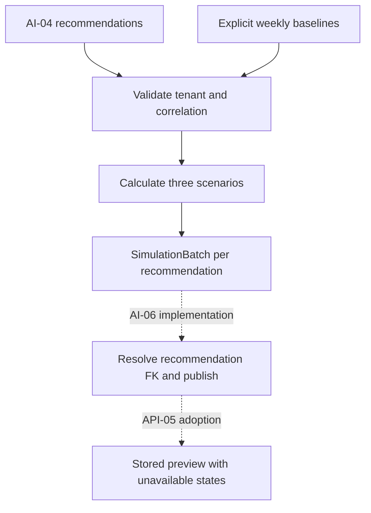

# AI-05 - Precomputed Action Simulator

## 1. Overview

AI-05 implements a deterministic what-if calculator for the three approved budget scenarios.
It consumes AI-04 recommendations and explicit seven-day baseline totals and returns the existing
ARCH-03 SimulationBatch. No database, HTTP, scheduling or external campaign action is performed.

Implementation baseline: main `9443642a2cdfbf6293eba7ffac645f65a8e3ee45`, 9 November 2026.
Computation is implemented on `feat/ai-05-action-simulator`; production persistence is not.
The Notion task remains In Progress until its stored-example and review/merge gates are met.

## 2. Scope

In scope: explicit baseline DTO, proportional scenario calculation, ratio/zero semantics,
correlation and tenant validation, deterministic ordering, meaningful tests and documentation.

Out of scope: baseline forecasting/estimation, DB queries and writes, AI-06 orchestration,
Worker invocation/cancellation, endpoints, live actions, UI, migrations, arbitrary scenarios,
new model dependencies, DEV-02 cleanup and changes to upstream algorithms.

## 3. Prerequisites

| Source | Why required |
|---|---|
| AI-04 (Done in Notion) | Real immutable Recommendation and stable campaign/rule correlation |
| DATA-01 (Done in Notion) | Existing action_simulations schema, enum, FK and nonnegative constraints |
| ARCH-03 (merged; ADR 0002 prepared for review) | SimulationBatch, scenario horizon, unavailable markers and AI-06 persistence ownership |
| AI Layer Design Document section 1.7 | Original linear budget/spend and constant conversion efficiency intent |
| [Action simulation contract](../contracts/action-simulation.md) | Canonical calculation/input semantics delivered with this implementation |

AI-06 is a downstream persistence acceptance dependency, not a module imported by AI-05.

## 4. Architecture

The functional core consumes immutable input and returns immutable output. The imperative shell
and storage remain downstream. Reuse existing Pydantic/Decimal and ARCH-03 output types; no new
framework, database abstraction, provider client or service boundary.



## 5. Step-by-Step Implementation Walkthrough

### Practical outcome

A caller can supply a weekly baseline of spend 700, conversions 35 and revenue 2100, and obtain
-20% spend 560/conversions 28 and +15% spend 805/conversions 40.25, both CPA 20/ROAS 3.
Pause has zero spend/conversions and explicit unavailable ratios. It is a consistent preview,
not evidence that a real campaign responds linearly.

### Acceptance criteria to steps and evidence

| Acceptance criterion | Steps | Verification evidence / status |
|---|---|---|
| Three nonnegative scenario projections | 1-3 | Hand-calculated arithmetic, fractional and zero tests; results in section 14 |
| Explicit assumptions | 1, 3 | Baseline source, dates, units, version and limitations asserted in tests |
| Results persist in action_simulations | 4 | NOT RUN - AI-06 production adapter absent; no DB inserts claimed |
| No live external writes | 2-4 | Pure implementation; in-memory AI-01/04/05 test; no provider/session calls |

### Step 1 - Define the explicit seven-day input

- **What:** Remove ambiguity between daily values, point forecasts and weekly totals.
- **Where:** `ai/simulation/schemas.py`, SimulationBaseline; canonical action simulation contract.
- **How it works:** The caller supplies nonnegative finite Decimal totals, identities, cutoff and
  a nonblank source. Pydantic rejects unknown fields and mutation. Missing data is not zero.
- **Testing:** Missing revenue, negative/NaN/infinite values, untyped strings, blank source,
  unsupported horizon and unknown fields are rejected by the focused suite.

### Step 2 - Validate the complete handoff

- **What:** Prevent tenant leakage and ambiguous recommendation-to-simulation matching.
- **Where:** `ai/simulation/engine.py`, simulate_actions.
- **How it works:** Validate all baselines against explicit organization/as_of; index unique
  campaign IDs. Validate recommendations, nonblank rule IDs, unique campaign/rule pairs and
  baseline presence before computing. Return batches sorted by UUID/rule, independent of input order.
- **Testing:** Foreign/stale baselines (including unused ones), foreign recommendations, missing
  matches, duplicate keys, malformed items and reversed generators are covered.

### Step 3 - Calculate and explain three scenarios

- **What:** Apply the bounded heuristic consistently, including ratios and pause.
- **Where:** private _simulate; existing SimulationProjection/SimulationBatch.
- **How it works:** Follow [canonical formulas](../contracts/action-simulation.md#formulas-and-assumptions).
  A pinned Decimal context isolates results from process-global precision. Revenue participates
  in ROAS calculation even though it is not a table output column. Assumptions travel with each batch.
- **Testing:** Hand-calculated totals/ratios, zero denominators versus measured zero, fractional
  conversions, JSON round-trip and altered ambient precision are covered.

The 11 November follow-up also pins all Context constructor settings instead of inheriting
mutable DefaultContext. Assumptions are formatted within that same context. Regression tests
exercise altered defaults before import in a separate process and ambient lowercase exponent
formatting, in addition to precision and rounding. Scope, formulas and output fields are unchanged.

### Step 4 - Hand off to persistence without a dependency cycle

- **What:** Make the module ready for AI-06 while preserving its ownership boundary.
- **Where:** `ai/simulation/__init__.py` public exports and integration contract section 4.
- **How it works:** AI-06 will correlate organization/campaign/rule in its model run, assign parent
  recommendation IDs and insert simulations in the whole-run transaction. Assumptions and markers
  must survive in recommendation evidence. AI-05 never imports AI-06 or updates a human decision.
- **Testing:** Actual AI-01/AI-04 output feeds AI-05 in memory. Actual stored-example acceptance
  is NOT RUN - production publication adapter belongs to AI-06 and is absent on this baseline.

The full planned sequence is [recorded separately](plans/action-simulator-execution.md).

## 6. Inputs

| Input | Required | Source / validation |
|---|---|---|
| recommendations | Yes; iterable may be empty | Real AI-04 Recommendation; matching tenant, UUID campaign, nonblank rule, unique key |
| baselines | Yes; iterable may be empty | SimulationBaseline; exact fields and semantics in the canonical simulation contract |
| organization_id | Yes; keyword UUID | Trusted caller scope; must match all inputs |
| as_of | Yes; keyword calendar date | Fixed caller cutoff, equal across baselines; horizon must fit supported calendar |

No implicit loader, training range, forecast conversion, data filling or currency conversion.
Caller validates selected campaign authorization and the origin/units of baseline totals.

## 7. Outputs

`tuple[SimulationBatch, ...]`: one batch per recommendation correlation key. Existing
[ARCH-03 types and output mapping](../contracts/ai-pipeline-and-persistence.md#recommendations-and-simulations)
remain canonical. Re-export SimulationBatch and SimulationProjection for consumer convenience.
No IDs, timestamps, persistence outcome or projected_revenue column are added.

## 8. Rules and Semantics

The single definition is [action-simulation.md](../contracts/action-simulation.md), including
formula provenance, baseline responsibility, precision, ordering, gaps, missing values and markers.
The implementation preserves efficiency ratios under positive proportional scaling. It does not
claim a causal effect, confidence interval, improved ROAS or empirically measured forecast accuracy.

## 9. Public Interfaces

```python
from sawakli.ai.simulation import SimulationBaseline, simulate_actions

batches = simulate_actions(
    recommendations,
    baselines,
    organization_id=organization_id,
    as_of=as_of,
)
```

SimulationBaseline construction raises Pydantic ValidationError for malformed fields.
simulate_actions raises ContractError for inconsistent scope, missing/duplicate identity or
unsupported arithmetic/calendar range. Both are ValueError-family failures. No side effects.

## 10. Data Ownership

Reads: caller-supplied AI-04 recommendations and authorized analytical baseline totals only.
Writes: new immutable in-memory results only. AI-06 owns all simulation INSERTs and FK mapping.
Must never read: users, credentials, OAuth tokens, raw provider payloads or unauthorized campaigns.
Must never write: canonical facts, recommendation decision status, jobs or external campaigns.

## 11. Security

Explicit tenant identity is checked on every input, not inferred from campaign names. Duplicate
keys are rejected. This in-memory boundary is not authentication or a substitute for upstream
selected-campaign authorization/database roles. Baseline source text must describe analytical
provenance, not contain credentials or secrets. No logs or environment access are added.

## 12. Error and Edge-Case Behavior

| Case | Behavior |
|---|---|
| No recommendations | Empty tuple after validating supplied baselines |
| Recommendation without baseline | ContractError; never silently drop it |
| Negative/nonfinite/missing totals | ValidationError on typed input construction |
| Zero numerator, positive denominator | Valid zero ratio, without unavailable marker |
| Zero denominator | Marked numeric-zero sentinel, including non-pause scenarios |
| Sparse/gapped historical data | No estimator here; caller must provide justified totals or defer this stage |
| Duplicate baseline/key | ContractError |
| Wrong tenant/cutoff | ContractError, even on unused baseline |
| Out-of-range arithmetic/calendar | ContractError; no fabricated defaults |
| Database/provider failure | N/A - no DB/network access in calculation |
| Cancellation/timeout | N/A inside this short bounded call; AI-06/Worker checks around stages |

## 13. Testing

`apps/backend/tests/unit/ai/test_simulation.py` tests public behavior: known arithmetic, aggregate
ratios, provenance, JSON shape, fractional conversions, immutability, scope, duplicates, missing
data, deterministic reordering and Decimal precision. A real AI-01 feature/AI-04 recommendation
flow generates a spend_waste recommendation and feeds it to AI-05 without mutation or DB I/O.

Existing ARCH-03 projection validators, fixture checks and negative tests remain active and
unchanged. No allowlist is loosened. DB publication/E2E acceptance is downstream, not simulated
by a mocked session or a SQLite substitute.

## 14. Verification

Executed 9 November 2026 in an isolated Python 3.12.14 environment, Node 24.22.1,
based on main `9443642`. Commands below run in `apps/backend` unless stated otherwise.

| Command / check | Result |
|---|---|
| `pytest tests/unit/ai/test_simulation.py -q` | PASS - 43 tests |
| `pytest tests/unit -q` | PASS - 302 tests, zero skips; two dependency deprecation warnings |
| `ruff check .` | PASS |
| `ruff format --check .` | PASS - 177 files |
| `mypy src` | PASS - 99 source files, strict configuration |
| Root `node scripts/run-contracts.mjs` | PASS - six commands; 27 ARCH-03 corruptions and 23 existing mismatch cases rejected |
| `git diff --check` | PASS |
| `bash .github/scripts/check-documentation-governance.sh 9443642 HEAD` | PASS - current 17-section task document and same-change documentation |
| PostgreSQL publication / migrations | NOT RUN - PostgreSQL binaries absent; production AI-06 adapter is not implemented |
| Docker Compose integration | NOT RUN - Docker executable absent |
| Frontend lint/types/build/tests | NOT RUN - frontend unchanged; configured CI remains the adoption gate |
| Remote CI on published implementation c8c3120 | FAIL - run 42671542634 ended before creating jobs; GitHub annotation: Internal server error (correlation 0483a680-b14b-4904-a405-2ae7e46c0b58) |
| Independent review | NOT RUN - awaiting affected-owner review |

The 43 simulator cases are included in the 302 unit total. Dependencies were installed from
the existing project ranges in an isolated environment; no dependency manifests or lockfiles
were changed. Warnings are existing FastAPI/Starlette httpx and passlib crypt deprecations.

No full-product E2E, stored simulation example, causal model accuracy, remote approval or merge
is claimed by these local results.

### 11 November branch review and localhost verification

Reviewed clean branch `feat/ai-05-action-simulator` at `d49c593`, two commits ahead of
`origin/main` (`9443642`), with no merge conflicts and draft PR #33. The user explicitly
authorized fixes, builds, localhost testing and a merge after resolution. Human review remains
required by repository governance; no approval is inferred from a green check.

Two defects were reproduced on a temporary copy of the original source: altered Decimal
DefaultContext could turn valid input into ContractError, and ambient lowercase exponent
formatting could change assumptions text. The follow-up explicitly pins all numeric settings
and formats assumptions inside the same context. Existing formulas, scenarios, tenant checks,
output fields, layer ownership and persistence boundaries are preserved.

Verification uses Python 3.12.3, Node 24.22.2 and PostgreSQL 18.6. Backend dependencies come
from the committed `uv.lock` via `uv sync --frozen --extra dev`; frontend dependencies come
from `npm ci`. No dependency manifest or lockfile is changed. Docker's daemon is unavailable,
so native PostgreSQL binaries are extracted under `/tmp`, with separate test and migration
round-trip servers on loopback ports 55434 and 55435. Test databases are disposable and are
separate from the `sawakli_local` development database.

| Command / check | Result |
|---|---|
| Original-source `python -m pytest tests/unit/ai/test_simulation.py -k 'ambient_decimal_context or decimal_defaults_before_import' -q` in a temporary copy with the new tests | FAIL - expected reproduction: two failures, one pass; assumptions mismatch and decimal.Inexact converted to ContractError |
| Backend `.venv/bin/pytest tests/unit/ai/test_simulation.py -q` | PASS - 45 tests |
| Root `apps/backend/.venv/bin/python -m pytest -c apps/backend/pyproject.toml apps/backend/tests -rs --junitxml=/tmp/sawakli-pytest-results.xml` with the two test DB URLs | PASS - 433 tests, zero failures/errors/skips; four existing deprecation warnings |
| JUnit XML assertion for tests/failures/errors/skips | PASS - 433/0/0/0 |
| Backend `.venv/bin/ruff check .` | PASS |
| Backend `.venv/bin/ruff format --check .` | PASS - 177 files |
| Backend `.venv/bin/mypy src` | PASS - 99 source files |
| Root `node scripts/run-contracts.mjs`, with Node 24 and the backend venv on PATH | PASS - 6/6 commands, including 27 ARCH-03 and 23 QA-00 negative cases |
| Root `python scripts/integration_harness.py fresh-db DATABASE_URL TEST_DATABASE_URL` with the backend venv | PASS - both disposable PostgreSQL databases recreated and migrated |
| Root `python scripts/integration_harness.py roundtrip` with the backend venv | PASS - 23 tables at head, zero after downgrade, 23 after upgrade |
| Backend `uv build --out-dir /tmp/sawakli-backend-dist` | PASS - source distribution and wheel built; existing missing backend README warning |
| Frontend `npm run lint` | PASS - zero errors, two existing unused mock-organization argument warnings |
| Frontend `npm run type-check` | PASS |
| Frontend `npm run build` | PASS - production build; existing middleware deprecation warning |
| Frontend `npm test` | PASS - three tests in two files |
| Frontend `npm audit --json` | FAIL - 17 existing findings: eight moderate, six high, three critical; Next.js and Vitest updates need a separate scope decision |
| `curl --fail http://localhost:3000/login` | PASS - HTTP 200; demo workspace entry present |
| `curl --fail http://localhost:8000/health` | PASS - HTTP 200 with status ok |
| `curl --fail http://localhost:8000/docs` and `/openapi.json` | PASS - HTTP 200 |
| Worker process and `/tmp/worker_heartbeat` | PASS - heartbeat advances against the development database |
| `git diff --check` | PASS |
| `bash .github/scripts/check-documentation-governance.sh origin/main HEAD` | PASS |
| Docker Compose build / integration | NOT RUN — Docker daemon stopped; native builds and PostgreSQL checks run instead |
| Interactive browser verification | NOT RUN — browser access host unavailable |

The first contract invocation lacked `python` on PATH; it failed closed with
`spawnSync python ENOTDIR`. Adding the venv to PATH made the complete suite pass. The first
post-fix lint invocation reported one 102-character string line; splitting the literal preserved
the output and the rerun passed. The full backend suite was interrupted by the session restart;
after recreating the two test databases, the resumed run passed all 433 tests in 157.55 seconds.

Local testing: open `http://localhost:3000`, select **Open demo workspace**, then use the demo
setup path. Real API registration/login and interactive API calls are available at
`http://localhost:8000/docs`. The UI recommendation/simulation services still return mocks;
this does not exercise the AI-05 calculator through HTTP. Use the focused Python tests above
to exercise actual simulator calculations. Production persistence remains AI-06 work.

## 15. Known Limitations

- Caller-provided baseline estimates and currency consistency are trusted inputs, not verified data quality.
- The model is linear and cannot model saturation, seasonality, attribution lag or causal lift.
- Complete production run publication, API availability states and actual stored examples are absent.
- ADR 0002's recorded status remains prepared for review; this task does not fabricate acceptance.
- No live campaign updates, general simulation engine or additional model quality claims.
- The existing frontend dependency tree has 17 npm audit findings at the 11 November review;
  dependency security remediation is not included in this focused simulator fix.

## 16. Follow-Up Tasks

- AI-06 - supply justified weekly baseline totals, call simulator, preserve assumptions/markers,
  resolve parent IDs and demonstrate actual PostgreSQL whole-run publication and replay.
- API-05 / UI-07 - display stored previews with marked CPA/ROAS as unavailable.
- WORK-04 - invoke the production AI-06 stage under existing lifecycle/cancellation contracts.
- Affected owners - review the canonical calculation/input refinement and code/document consistency.
- Frontend dependency security follow-up - on 11 November the user explicitly chose to keep
  AI-05 focused. In a separate change, update vulnerable Next.js/Vitest and transitive packages,
  assess major Vitest migration impact, rerun lint/types/build/tests and npm audit, and verify
  the 17 reported findings are resolved. No dependency versions change in this PR.

The persisted-example requirement remains an open acceptance gate, not an optional enhancement.

## 17. References and Evidence

- [Notion AI-05](https://app.notion.com/p/3bc7de83a91b81ec87d5e557b0a5bf60)
- [Canonical calculation contract](../contracts/action-simulation.md)
- [Canonical AI integration contract](../contracts/ai-pipeline-and-persistence.md)
- [ADR 0002](../adr/0002-ai-pipeline-and-persistence-boundaries.md)
- [AI-04 documentation](AI-04-recommendation-engine.md)
- [Execution plan](plans/action-simulator-execution.md)
- [Separate explanatory guide](guides/action-simulator-walkthrough.md)
- Original supplied AI Layer Design Document, section 1.7 (linear budget/spend; constant conversion rate).
- Repository tests: `apps/backend/tests/unit/ai/test_simulation.py`; exact results in section 14.
- [Draft PR #33](https://github.com/HusseinElhaddad/Sawakli-AI/pull/33).
- [Initial CI run](https://github.com/HusseinElhaddad/Sawakli-AI/actions/runs/42671542634): failed before jobs started, with GitHub internal server error. Subsequent CI state belongs to the PR evidence, not an inferred pass.
