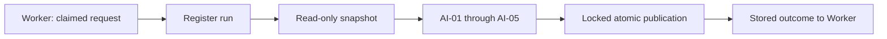
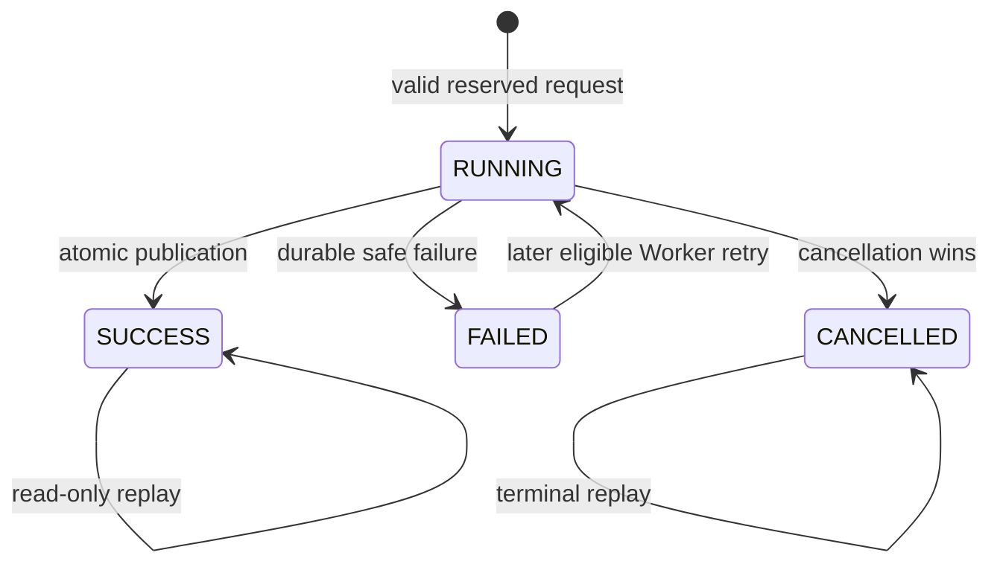

# AI-06 - Pipeline Orchestrator and Output Persistence

## 1. Overview

AI-06 provides one deterministic execution boundary for a reserved Background Worker
job. It composes the real AI-01 through AI-05 modules and publishes a complete linked
set of AI outputs in PostgreSQL. A successful replay returns the stored outcome
without computing or inserting again.

Implementation is on `feat/ai-06-pipeline`, based on fetched `main` at
`25de23a064d9c315fed6b317221f5da939803380`. Independent affected-owner review, final CI
acceptance and merge remain gates. This document does not claim that WORK-04's
production dispatcher is implemented. The existing executor is still a placeholder.

## 2. Scope

AI owns creation/finalization of `model_runs` and insertion of forecasts, anomalies,
recommendations and simulations. It owns baseline preparation and analytical boundary
adaptation. Worker retains job claiming, run-ID reservation, status transitions,
timeout recovery, cancellation initiation, attempt limits and retry scheduling.

No new service, queue, ORM, runtime dependency, endpoint or analytical threshold is
introduced. DEV-02 dependency cleanup, runtime logins/RLS rollout, immutable dataset
versions, leases, external campaign execution and output-serving APIs are excluded.

## 3. Prerequisites

| Source | Use and observed state |
|---|---|
| [AI-01](AI-01-feature-pipeline.md) | Real scoped loader, facts, features and scope guard |
| [AI-02](AI-02-anomaly-detection.md) | Real ensemble; additive structured evidence seam |
| [AI-03](AI-03-forecasting.md) | Real point forecasts and missing-history state |
| [AI-04](AI-04-recommendation-engine.md) | Real rules and explanation strings |
| [AI-05](AI-05-action-simulator.md) | Merged simulator, explicit baseline and three scenarios |
| DATA-01 | Applied schema, keys and query-only metadata convention |
| [Pipeline contract](../contracts/ai-pipeline-and-persistence.md) | Shared ownership, identity and publication protocol |
| [Simulation contract](../contracts/action-simulation.md) | Existing Decimal arithmetic and marker semantics |
| [ADR 0001](../adr/0001-runtime-boundaries-and-database-roles.md) | Accepted; runtime-role rollout remains deferred |
| [ADR 0002](../adr/0002-ai-pipeline-and-persistence-boundaries.md) | Prepared for affected-owner review; unchanged lifecycle |

Current Notion pages were read, including prerequisites and ARCH-03. Their task
properties report Done for AI-01..05, DATA-01 and ARCH-03, but some evidence text still
describes older open PRs. Those properties are not substituted for current code,
review or CI evidence. AI-06 remains In Progress. No dates, points or assignees change.

## 4. Architecture

The application service is the imperative shell around existing pure analytical
functions. It uses the existing synchronous SQLAlchemy Session factory, one fresh
Session per unit of work. The Core table handles remain outside Alembic metadata.



```mermaid
sequenceDiagram
    participant W as Worker
    participant A as AI-06
    participant D as PostgreSQL
    W->>D: Reserve stable run ID and commit (WORK-04)
    W->>A: run_pipeline(request, cancellation)
    A->>D: Short registration transaction
    A->>D: Read-only consistent input snapshot
    Note over A: Close read Session; compute real modules
    A->>D: Lock job; re-read run; insert all outputs + SUCCESS
    A->>W: Persisted PipelineOutcome
    W->>D: Complete job status (WORK-04)
```

## 5. Step-by-Step Implementation Walkthrough

### Practical outcome

A valid reserved request produces inspectable forecasts, critical metric-evidence
anomalies, explainable cards and three simulations per card. Calling it again cannot
duplicate publication or reset a human decision. The [full preimplementation plan](plans/ai-pipeline-execution.md)
is the linked execution appendix.

### Acceptance criteria to steps and evidence

| Requirement | Steps | Evidence |
|---|---|---|
| Real feature/anomaly/forecast/recommendation/simulation chain | 2-4 | Real-chain PostgreSQL test and evidence procedure |
| AI-owned runs and linked output persistence | 1, 4-5 | Tags/FK, scenario coverage and stored-row queries |
| Correct final outcomes and retry idempotency | 5-6 | Replay, failed retry, crash-window and race tests |
| Actual PostgreSQL stored example | 7 | Section 14; no mocked detector or persistence |
| Technical and explanatory documents | 7 | This source, linked plan and [learning guide](guides/ai-pipeline-implementation-explained.md) |

### Step 1 - Validate the reserved request

**What:** Refuse unauthorized or inconsistent input before analytical access.
**Where:** `ai/persistence.py`: `lock_job`, `register`, `read_run`, `validate_claim`.
**How it works:** Lock the tenant's job, compare reserved run ID, stored selection and
UTC creation-date cutoff. Check organization existence and selected-campaign ownership.
Inspect only the reserved run's owner before fetching full tenant-scoped run context.
Store the request and claim identity or return a stored terminal outcome.
**Testing:** Foreign IDs, actual foreign campaigns, mismatched run owner, unclaimed
jobs, duplicate selections and exhausted attempts are rejected without output writes.

### Step 2 - Freeze and engineer authorized input

**What:** Give every analytical stage the same materialized history.
**Where:** `ai/pipeline.py`: `_load`, `_compute`; AI-01 loader/engineer and scope guard.
**How it works:** One REPEATABLE READ, READ ONLY transaction reads owned campaigns
and all facts through `as_of`. Close the Session before engineering and fitting.
The scope guard rejects foreign/future/duplicate observations even after a faulty loader.
**Testing:** The integration test checks transaction settings and that zero pooled
connections remain checked out when computation begins; UTC cutoff excludes future facts.

### Step 3 - Expose and adapt actual anomaly evidence

**What:** Persist metric explanations without inventing a second detector.
**Where:** `anomaly/detector.py`: `_feature_statistics`, `_metric_evidence` and
`AnomalyResult.metric_evidence`; existing `integration.to_anomaly_signal`.
**How it works:** The Z and IQR branches and evidence use one per-feature calculation.
Only direct metrics with nonzero evidence are exposed. Critical diagnostics pass
through the canonical adapter; above/below comes from current versus earlier median,
not business-performance direction. All qualifying observation dates may be stored;
only a campaign's latest-date signals enrich its current cards.
**Testing:** Existing formula tests, hand-calculable contributions, original-vs-new
full diagnostic comparison and both unchanged benchmark seeds; see section 14.

### Step 4 - Forecast, prepare totals, recommend and simulate

**What:** Preserve model semantics and provide explicit simulation inputs.
**Where:** `_compute`, `prepare_baseline`, existing AI-03/04/05 public functions.
**How it works:** Reuse `persistable_forecasts`; missing forecasts are omitted with
warnings. Hussein approved historical-repeat-v1 on 14 November 2026: require every
date in `as_of-6..as_of`, including recorded zero days, and repeat the three aggregate
totals into the next week. Gaps omit only that campaign's cards/simulations and record
campaign/window/omitted-rule details in run metadata. Forecasts/anomalies remain valid.
Simulation batches resolve by organization + campaign + rule, with IDs assigned here.
**Testing:** Complete/gapped/zero/duplicate/tenant/order cases and non-pause undefined
ratio markers. No day-7 forecast is used as a seven-day total.

### Step 5 - Publish one complete run

**What:** Make linked outputs visible together or leave none of them visible.
**Where:** `_publish`, `_insert_outputs`, `save_outcome` and migration 0013.
**How it works:** Check cancellation, lock the same tenant job row as cancellation,
revalidate the claim, and re-read terminal success under the lock. Insert anomalies,
forecasts, cards and their simulations, then finalize SUCCESS in the same transaction.
A competitor seeing SUCCESS returns it. Failure rolls back the whole transaction.
**Testing:** Fault after every output INSERT leaves zero published rows; concurrent
publishers meet at a barrier after the earlier check and publish only once.

### Step 6 - Finalize failure, cancellation and replay

**What:** Keep retries safe and outcomes honest.
**Where:** `run_pipeline`, `finalize_failure`, `terminal`, `same_claim`.
**How it works:** Failed/cancelled outcomes use a separate short transaction. A later
eligible claim can restart a retryable FAILED row, preserving started_at. SUCCESS and
CANCELLED are replayed. Invalid inputs never become retryable. Failure-recording outages
propagate to Worker recovery. A late failing competitor cannot overwrite SUCCESS.
**Testing:** Computation/storage faults, failure-recording outage, three cancellation
checkpoints, eligible retry, human status preservation and both lock orderings.

### Step 7 - Demonstrate and hand off

**What:** Leave reproducible evidence and editable explanations.
**Where:** `scripts/ai06_evidence.py`, test fixture `tests/fixtures/ai06.py`, this document,
execution plan and learning guide.
**How it works:** Ingest synthetic CSV through the real Data boundary; use the existing
Worker claim query and an explicit fixture reservation; run the real pipeline; query
all linked rows; replay and compare exact rows. PDFs and raw logs remain outside git.
**Testing:** Section 14 contains actual commands and results; PR/CI evidence is updated
for the published head, without inventing review or merge acceptance.

## 6. Inputs

The [canonical request and cancellation contract](../contracts/ai-pipeline-and-persistence.md#2-worker-to-ai-input)
defines the fields. `run_pipeline(request, *, cancellation)` accepts only a frozen
PipelineRequest and a no-argument boolean observation callback. Authentication is
upstream; this internal boundary rechecks the stored job and ownership.

`as_of` is the UTC date of job creation, not wall-clock execution time. The current
PostgreSQL jobs.created_at column has no time zone; its writers must store UTC, and
AI interprets a stored naive timestamp as UTC rather than guessing a lost offset. Selection
must exactly match the stored job. None means all owned campaigns; empty/duplicate
selections are invalid. The reserved run is reused on retry. The callback must read
committed cancellation using its own short Session; Sessions are never shared across threads.

## 7. Outputs

PipelineOutcome preserves request IDs and returns SUCCESS, FAILED or CANCELLED, plus
the existing warning/error fields. Its schema is unchanged. See the canonical mapping
for table fields; AI-06 applies these adaptations:

| Output | Persistence detail |
|---|---|
| Anomaly | Observation midnight in detected_at; independent insertion created_at; structured evidence JSON with campaign_day score scope |
| Forecast | Usable AI-03 fields plus tenant/run/ID; unavailable rows omitted; allowed negative ROAS preserved |
| Recommendation | Original strings retained in JSON array; rule and simulator evidence appended; new status pending |
| Simulation | Three rows keyed to allocated recommendation ID; no fake organization/run columns; ownership derives through parent |
| Run | Existing audit fields plus nullable execution_metadata for exact replay, claim context and omissions |

UUIDs identify rows; analytical values/order are deterministic for equal facts and
configuration. A fresh logical run can receive new UUIDs/timestamps. Successful replay
preserves all stored identities. No output row is updated by retry.

## 8. Rules and Semantics

[Shared mapping, threshold, baseline and transaction rules](../contracts/ai-pipeline-and-persistence.md)
remain canonical. AI-02's critical score is campaign-day evidence, not independent
metric confidence. Its earlier-history medians and contribution floors are unchanged.
AI-03 point forecasts remain anchored to each metric's last usable observation,
including the original observed-point gap handling and negative-ROAS allowance.

The approved baseline is a complete historical calendar week. For seven recorded
days of 100/5/300, totals are 700/35/2100; the next week's -20% scenario is 560/28,
CPA 20 and ROAS 3. Missing dates are unknown, never measured zero. Pause uses the
schema's zero sentinels with cpa/roas unavailable markers. Non-pause zero denominators
also retain markers. API-05 must expose them as unavailable.



## 9. Public Interfaces

`run_pipeline(request: PipelineRequest, *, cancellation: CancellationCheck) -> PipelineOutcome`
is the Worker execution entry point. `prepare_baseline(request, records)` returns a
SimulationBaseline or None for unavailable history; it validates scope and duplicates.
Both use the existing analytical types. Private repository helpers do not add a new
service API. The dependency seam is the module's SessionLocal factory; tests substitute
a factory bound to a disposable database, never a shared mutable Session.

Migration 0013 adds `model_runs.execution_metadata` because existing fields cannot
replay warnings/omissions or distinguish later retry claims. The envelope is versioned
by request.contract_version and is defined in the canonical contract. No historical
migration or existing column semantics are rewritten. Legacy NULL-metadata rows are
refused without mutation rather than assigned invented outcomes.

## 10. Data Ownership

**Reads:** Owned campaigns/daily_metrics, scoped jobs and model_runs; a reserved-ID
owner-only check detects run collisions. AI-01 reads no GA events in DB mode.
**Writes:** Only model_runs and the four AI output tables. The evidence fixture uses
the real Data ingest function outside the production AI module.
**Must never read:** Tokens, credentials, users' password fields, provider bodies or
foreign tenant histories. The triggering user UUID is copied from the trusted job.
**Must never write:** Canonical facts, data sources, Worker job states, human card
statuses or provider campaigns. Query-only Core metadata never creates schema.

## 11. Security

Stored organization, job, campaign and run identity are checked before reads and again
before publication. Each output's tenant/run tag comes from the validated request;
module result identities are checked before adaptation. FK relationships resolve by
key. Error records contain only safe error codes; no SQL, raw exception, trace or secret
is stored or returned. No credentials enter the evidence data.

This is application-level isolation evidence. ADR 0001's runtime roles and RLS switch-on
remain deferred; superuser integration tests do not prove least-privilege enforcement.

## 12. Error and Edge-Case Behavior

| Case | Actual behavior |
|---|---|
| Empty workspace | SUCCESS, no_data, zero output rows |
| Sparse history | SUCCESS with insufficient_history; unavailable forecasts skipped |
| Incomplete baseline week | Preserve independent outputs, omit cards/simulations; campaign trace in metadata |
| Duplicate/foreign/future facts or wrong job identity | FAILED invalid_input, nonretryable; foreign state untouched |
| Unexpected computation error | Separate durable FAILED, computation_failed, retryable |
| Publication/storage error | Complete rollback; separate FAILED storage_failed when storage is reachable |
| Failure-recording database outage | Exception propagates; no fabricated durable outcome |
| Committed run, unfinished job | Exact SUCCESS replay, no computation or duplicated output |
| Repeated FAILED call without new claim | Nonretryable invalid_input response; saved run untouched |
| Cancellation before compute or publication | Durable terminal CANCELLED; zero output rows |
| Cancellation versus publication | Same job lock; first committed winner governs outcome |
| Timeout | Worker initiates cancellation/recovery; AI cooperates at checkpoints only |
| Provider/network API failure | N/A - production AI makes no provider calls |

## 13. Testing

Unit tests add hand-calculable baseline, date-gap, zero-day, duplicate, tenant and
reordering cases, plus structured anomaly contribution assertions. Existing detector
formula and benchmark tests remain unchanged.

PostgreSQL tests use the existing TEST_DATABASE_URL harness with _test name and live
current_database checks. They cover real ingestion/composition, tenant/run/FK tags,
exact scenario coverage and markers; empty/sparse/gapped data; foreign job/run/campaign
and cutoff rejection; malformed inputs; rollback; safe computation failure; retry
eligibility and attempt cap; callback and stored cancellation; exact replay and human
decisions; crash window; concurrent publishers and both cancellation lock orderings.
Threading Events/Barrier establish ordering; no timing-sensitive sleeps are used.

| Required case | Concrete PostgreSQL test (test_pipeline.py) |
|---|---|
| 1-5 real chain, tags/FKs, scenarios, markers, stored example | real_chain_atomic_tags_foreign_keys_markers_and_human_replay; zero_conversion_baseline; maintained evidence script |
| 6 empty workspace | empty_workspace |
| 7 sparse/forecast/baseline availability | sparse_and_gapped_baselines_preserve_independent_outputs |
| 8 foreign identities | foreign_or_inconsistent_request_rejected; actual_foreign_campaign; foreign_existing_run |
| 9 duplicate/invalid metric evidence | invalid_loaded_or_structured_data_is_nonretryable |
| 10 rollback after publication fault | publication_failure_rolls_back_every_output |
| 11 computation failure | computation_failure_eligible_retry_and_attempt_limit |
| 12 cancellation checkpoints | cancellation_is_terminal_and_publishes_nothing |
| 13 cancellation/publication ordering | publication_cancellation_lock_ordering_separate_sessions |
| 14 successful replay | real_chain_atomic_tags_foreign_keys_markers_and_human_replay |
| 15 eligible failed retry | computation_failure_eligible_retry_and_attempt_limit |
| 16 post-commit crash window | real_chain test leaves job RUNNING before replay |
| 17 preserve human decision | real_chain test approves rows before exact replay |
| 18 concurrent publication after earlier check | concurrent_publishers_recheck_success_after_optimistic_check |

Additional tests verify the released read-only snapshot, fixed UTC cutoff, attempt
eligibility, unavailable-ratio evidence and latest-observation-only anomaly enrichment.


Fault injection occurs at focused loader/computation/storage seams. It does not replace
the real-chain PostgreSQL test or retained example. E2E impact: the callable is ready
for WORK-04 integration, while UI/API still need their own real dispatch/serving work.

## 14. Verification

Execution date: 14 November 2026, Africa/Cairo. CPython 3.12.3, PostgreSQL 18.6,
SQLAlchemy 2.1.8, psycopg 3.3.9, NumPy 2.5.4, scikit-learn 1.9.1. Existing bounded
backend dependencies installed into `/tmp/ai06-venv`; no runtime dependency changes.

### Reproducible commands

From the repository root, in an activated backend environment:

```bash
export DATABASE_URL=postgresql+psycopg://postgres@127.0.0.1:55437/ai06_backend_test
export TEST_DATABASE_URL=postgresql+psycopg://postgres@127.0.0.1:55437/ai06_integration_test
python scripts/integration_harness.py fresh-db DATABASE_URL TEST_DATABASE_URL
cd apps/backend
pytest tests/unit/ai/test_pipeline.py tests/integration/ai/test_pipeline.py -q
pytest -q --junitxml=/tmp/ai06-pytest-results.xml
ruff check . ../../scripts/ai06_evidence.py
ruff format --check . ../../scripts/ai06_evidence.py
mypy src
cd ../..
node scripts/run-contracts.mjs
PYTHONPATH=apps/backend/src:apps/backend python scripts/ai06_detector_equivalence.py \
  --base-ref 25de23a064d9c315fed6b317221f5da939803380
ROUNDTRIP_DATABASE_URL=postgresql+psycopg://postgres@127.0.0.1:55438/ai06_roundtrip \
  python scripts/integration_harness.py roundtrip
PYTHONPATH=apps/backend/src:apps/backend DATABASE_URL="$TEST_DATABASE_URL" \
  python scripts/ai06_evidence.py > /tmp/ai06-persisted-evidence-final.json
git diff --check
bash .github/scripts/check-documentation-governance.sh origin/main HEAD
```

The local clusters are disposable native servers in /tmp. The round-trip uses a
separate server because migration 0007 drops cluster-wide roles. Standard Compose
postgres-test and the configured CI services are equivalent supported routes; use
matching URLs and guarded test names. Never aim fresh-db at development/production.

### Executed results

| Check | Result |
|---|---|
| Guarded fresh-db on both dedicated test databases | PASS - applied migration head |
| Focused AI-06 unit/PostgreSQL suite | PASS - 38 tests, zero skips |
| Full backend regression | PASS - 486 tests, zero skips, 159.15 seconds; final latest-observation test additionally passed separately and in focused suite |
| Ruff lint and formatting, including both new scripts | PASS - 189 backend files formatted; no lint errors |
| Strict mypy src | PASS - 103 source files |
| Root contracts and negative cases | PASS - all six commands; 27 AI fixture failures and 23 other injected mismatches rejected |
| Original-base detector equivalence | PASS - all original fields on 10,800 diagnostics identical, including Decimal representation |
| PostgreSQL migration round-trip | PASS - 23 tables at head, zero after downgrade, 23 after re-upgrade |
| Stored example and exact replay | PASS - real canonical ingestion, analytical modules and PostgreSQL writes |
| Local Compose build/integration | NOT RUN — Docker daemon unavailable; docker compose build could not connect to its socket |
| Whitespace | PASS - git diff --check |
| Governance and exact-head CI | Publication evidence recorded below; no pending run is a PASS |

Original-vs-new evidence is reproducible with scripts/ai06_detector_equivalence.py
against the actual base SHA above. Diagnostic hashes over all original fields:

```text
20261015: 9e24ac9ef94d90fae7b5db3c71bb837bcce028fc60822acfd36036aab9bd9e16
20261016: 1b2d8c043eb11ca8ac5f939208b0c391906229256ad0cb85d5c85c422c87583f
```

| Seed | Event recall | Anomalous-day recall | Clean-day FPR | Clean-campaign FPR |
|---|---:|---:|---:|---:|
| 20261015 | 30/30 | 149/152 | 62/5248 | 0/30 |
| 20261016 | 30/30 | 144/152 | 59/5248 | 1/30 |

All declared gates pass at the unchanged 0.80 threshold. These results describe the
versioned retrospective reference benchmark, not historical Nour quality or causal
simulation accuracy. Full raw logs and equivalence JSON remain in /tmp/ai06-* outside git.

Earlier failed invocations are retained honestly: the first real DB test found string
query handles for enum columns (fixed to actual PostgreSQL enums); the first full run
had 485 PASS and one failing new UTC fixture, corrected to store the schema's naive
jobs timestamp under the required UTC convention. A subsequent full rerun without
fresh seeds was interrupted after two seed-dependent failures; the existing client
fixture deletes organizations. Recreating the guarded regression DB yielded the full
486 PASS above. Initial root validator execution hit sandbox subprocess EPERM; the
same checks passed with process access. No skip, allowlist or quality gate was loosened.

### Stored example and replay

The real procedure produced organization `e856b6bf-ef49-4b4c-92e6-c475435b58fb`, job
`f520d707-4578-4a01-9e2c-e669371ae6e2`, run `6b8a8771-3a7d-429d-a888-fc6dd5c10ef2`,
and campaign `68f15b6d-a74a-4e79-99f3-fccd7b4d175e`, cutoff 2026-01-21. Its 21 source
days were ingested through the Data boundary, not inserted as fabricated AI outputs.

| Stored table | Before replay | After replay |
|---|---:|---:|
| model_runs | 1 | 1 |
| anomalies | 5 | 5 |
| forecasts | 9 | 9 |
| recommendations | 3 | 3 |
| action_simulations | 9 | 9 |

Status SUCCESS; warning undefined_ratios. All exact stored rows, including UUIDs,
timestamps, evidence and relationships, matched after replay. Job remained RUNNING,
demonstrating the post-publication/pre-Worker-completion window. Raw synthetic evidence
is `/tmp/ai06-persisted-evidence-final.json`; rows remain in ai06_integration_test for this
session. UUIDs change on a new demonstration invocation; the same request replay does not.
This supplies AI-05's outstanding stored-example evidence, pending review/merge acceptance.

To inspect relationships, use a Session or psql against that disposable database:

```sql
SELECT r.id, r.status, r.execution_metadata
FROM model_runs r WHERE r.id = '6b8a8771-3a7d-429d-a888-fc6dd5c10ef2';
SELECT r.id, r.campaign_id, r.source_anomaly_id, count(s.id)
FROM recommendations r JOIN action_simulations s ON s.recommendation_id = r.id
WHERE r.model_run_id = '6b8a8771-3a7d-429d-a888-fc6dd5c10ef2'
GROUP BY r.id;
```

## 15. Known Limitations

Cancellation is cooperative; an in-flight sklearn fit finishes before the next check.
Worker must serialize active attempts, use fresh cancellation Sessions, reconcile
committed run success before timeout recovery, and avoid concurrently retrying a still
active fit. AI-06 does not supply distributed exactly-once execution or stale leases.

Equal facts/configuration yield equal analytical results, but corrections to old facts
can change a failed retry. Successful replay uses persisted results. Snapshot/versioning
beyond one attempt is deferred. Historical-repeat baselines are explicit heuristics,
not validated weekly forecasts or causal response estimates. Currency consistency
inherits canonical input's single-currency assumption. Optional DB-mode GA values
remain unavailable. API-05 must interpret ratio sentinels and omission metadata.

Legacy runs without execution_metadata cannot be safely replayed by this implementation.
No review, ADR acceptance, real production dispatch or runtime-role rollout is implied.

## 16. Follow-Up Tasks

- WORK-04 / El-Farouk: reserve/reuse the run ID, commit claim quickly, call this boundary,
  validate returned identities, serialize retries and cancellation, reconcile crash/timeout success.
- API-05 / Ahmed and UI owner: serve stored outcomes/cards/simulations and expose marked ratios
  as unavailable; show missing-history and omitted-campaign states.
- AI-07 / Hussein and QA: broader isolation/security/coverage acceptance and role-scoped tests.
- Affected owners: review the schema/contract/baseline adoption and code/document consistency;
  independent review and merge are required acceptance gates, not optional enhancements.
- ADR 0001 rollout owners: runtime least-privilege credentials and GA grants, outside AI-06.

## 17. References and Evidence

- [AI-06 Notion task](https://app.notion.com/p/3bc7de83a91b816ab854eafc14663119)
- [Execution plan](plans/ai-pipeline-execution.md)
- [Implementation and learning guide](guides/ai-pipeline-implementation-explained.md)
- [Pipeline contract](../contracts/ai-pipeline-and-persistence.md)
- [Simulation contract](../contracts/action-simulation.md)
- [Canonical schema](../../tests/contracts/canonical.json)
- [Pipeline source](../../apps/backend/src/sawakli/ai/pipeline.py)
- [Persistence source](../../apps/backend/src/sawakli/ai/persistence.py)
- [PostgreSQL integration tests](../../apps/backend/tests/integration/ai/test_pipeline.py)
- [Evidence command](../../scripts/ai06_evidence.py)
- PR, final commits, exact-head CI and delivered PDF evidence: publication record below.
