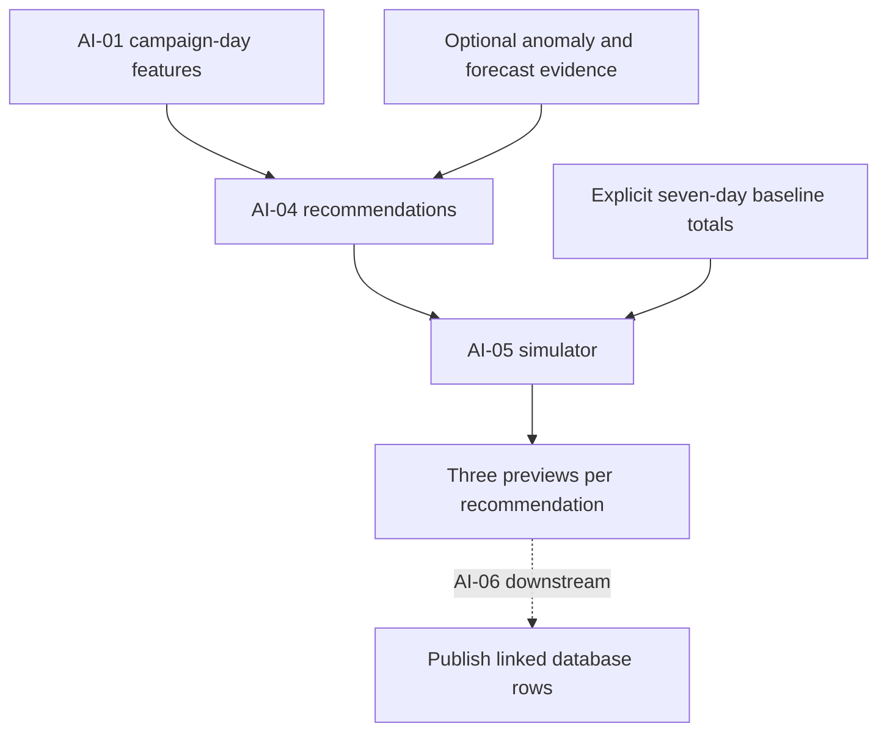

# AI-05 implementation and learning guide

This companion explains the implemented simulator from scratch. The permanent technical record is
[AI-05 task documentation](../AI-05-action-simulator.md); the exact calculation contract is
[action-simulation.md](../../contracts/action-simulation.md). Read those for authoritative behavior.

## 1. The problem this task solves

Sawakli can recognize a campaign problem and produce a recommendation. A user then needs a preview:
what would the numbers look like if we reduced the budget, increased it slightly, or paused it?

AI-05 supplies that preview for exactly three scenarios. It calculates numbers in memory and
returns them. It does not change the real campaign and does not save rows by itself. Keeping
calculation separate from storage makes it easier to test and prevents AI-05 from depending on
AI-06, which will eventually call it.

Think of a calculator: you supply explicit assumptions, it performs consistent arithmetic, and
another part of the application decides how to display or save the result. It is not a trained
model of real advertising response.

**Understanding checkpoint:** Why can a simulator be useful even when it does not execute actions?
Because it lets a human compare bounded previews before making a decision. Accuracy claims still
require separate real-world evaluation, which this task does not claim.

## 2. Where AI-05 sits



AI-01 computes ratios and trends. AI-02 identifies unusual history. AI-03 projects supported
metrics at future dates. AI-04 creates recommendations using rules and optional evidence.
AI-05 compares the approved scenarios. AI-06 will coordinate the complete pipeline and save
results. Each task has a focused responsibility.

The solid AI-04-to-AI-05 handoff is tested in memory. The dashed publication step is still future
runtime integration, not something the picture claims to be working end to end.

## 3. What a baseline means

A baseline answers: **what totals are we using for the next seven days if no action is taken?**
The new SimulationBaseline contains organization ID, campaign ID, cutoff date, spend, expected
conversions, revenue, a source description, and the fixed seven-day horizon.

Suppose as_of is 9 November 2026. The covered preview period is 10-16 November inclusive. The
totals are not values for just 16 November. This distinction matters because AI-03's day-7 point
forecast is not automatically the total of all seven days.

For a simple teaching example, assume daily performance stays at spend 100, conversions 5 and
revenue 300. Seven-day totals are then spend 700, conversions 35 and revenue 2100. The source
must say that constant daily performance was assumed. The simulator does not secretly make this
estimate for a real campaign.

The caller must justify the baseline, preserve currency consistency and use authorized data.
This implementation does not introduce another forecasting model, choose a history window or fill
missing days with zero. If a usable baseline cannot be supplied, the caller needs to handle that
state rather than pretend an estimate exists.

### The input type

SimulationBaseline is a Pydantic model derived from the existing strict ContractModel:

- **Frozen:** ordinary field reassignment is rejected.
- **Extra fields forbidden:** a misspelled or unexpected input does not disappear silently.
- **Strict numeric inputs:** Python callers supply Decimal, not approximate floats or arbitrary text.
- **Field checks:** totals must be finite and nonnegative; source must contain text.

Construct a baseline with explicit analytical values:

```python
baseline = SimulationBaseline(
    organization_id=organization_id,
    campaign_id=campaign_id,
    as_of=date(2026, 11, 9),
    spend=Decimal("700"),
    conversions=Decimal("35"),
    revenue=Decimal("2100"),
    source="Synthetic example: constant daily spend 100, conversions 5, revenue 300.",
)
```

The UUID variables above identify an authorized organization and campaign. A generated random
organization ID for each observation would break that identity; keep real entity IDs stable.

## 4. The arithmetic, one scenario at a time

The three multipliers are 0.80, 1.15 and 0. Each applies to spend, expected conversions and
revenue. This assumes constant acquisition efficiency and constant value per conversion.

| Scenario | Spend | Expected conversions | Revenue used in calculation | CPA | ROAS |
|---|---:|---:|---:|---:|---:|
| No-action baseline | 700 | 35 | 2100 | 20 | 3 |
| Budget -20% | 560 | 28 | 1680 | 20 | 3 |
| Budget +15% | 805 | 40.25 | 2415 | 20 | 3 |
| Pause | 0 | 0 | 0 | Unavailable | Unavailable |

For -20%, spend is 700 × 0.80 = 560. Conversions are 35 × 0.80 = 28. Revenue is
2100 × 0.80 = 1680. CPA is 560 / 28 = 20. ROAS is 1680 / 560 = 3.

For +15%, expected conversions are 35 × 1.15 = 40.25. A fractional expectation is allowed:
it describes an analytical projection, not a claim that a quarter of a customer was observed.
Rounding to 40 would change CPA and introduce an artificial efficiency change.

### Why the ratios stay unchanged

When the multiplier is positive, both the numerator and denominator of each ratio scale together.
For CPA, (S × m) / (C × m) = S / C. For ROAS, (R × m) / (S × m) = R / S.

This is a consequence of the heuristic. Increasing budget does not automatically improve ROAS.
A more realistic response model might include saturation, auction effects, seasonality and
attribution lag, but those behaviors are not estimated here.

Revenue is calculated internally for ROAS and included in the baseline assumptions. The existing
SimulationProjection/table does not contain projected_revenue; this task does not add a column.

**Understanding checkpoint:** If your output shows ROAS improving after multiplying every total
by the same positive number, what should you investigate? Look for inconsistent inputs, rounding
or a different formula. That improvement does not follow from proportional-v1.

## 5. Ratios of totals, not averages of ratios

Suppose one day spends 100 with 5 conversions and revenue 300; another spends 150 with 15
conversions and revenue 300. Daily CPAs are 20 and 10. Averaging them gives 15, but aggregate
CPA is total spend 250 / total conversions 20 = 12.5. Aggregate ROAS is 600 / 250 = 2.4,
not the daily ROAS average (3 + 2) / 2 = 2.5.

The simulator accepts totals and recomputes ratios from them. It never averages supplied CPA or
ROAS values. That is why the input needs spend, conversions and revenue rather than only ratios.

## 6. Missing, zero and unavailable

These are three different situations:

| Situation | Meaning | Behavior |
|---|---|---|
| Revenue missing | We do not know the input | Reject; do not invent zero revenue |
| Revenue 0, spend positive | Known zero return | ROAS 0 is a valid numeric result |
| Spend 0 | ROAS denominator is zero | ROAS unavailable, with a marker |
| Conversions 0 | CPA denominator is zero | CPA unavailable, with a marker |

The current database requires numeric CPA and ROAS. ARCH-03 therefore defines a numeric-zero
sentinel plus explicit undefined_ratios markers. Pause has zero spend and conversions, so both
ratios are marked unavailable. The zeros are a storage representation, not performance claims.

This rule also applies to non-pause cases. If the baseline has spend 100 and conversions 0,
the decreased-budget projection has spend 80 and conversions 0. CPA must still be marked
unavailable. It is not a measured acquisition cost of zero.

AI-06 must preserve those markers when storing a batch, and API-05 must expose unavailable states
instead of letting a dashboard present the sentinel as an excellent CPA.

## 7. Read the code by following one call

The public import is:

```python
from sawakli.ai.simulation import SimulationBaseline, simulate_actions

batches = simulate_actions(
    recommendations,
    baselines,
    organization_id=organization_id,
    as_of=as_of,
)
```

The asterisk in the function signature makes organization_id and as_of keyword-only. A caller
must label those arguments explicitly. The iterables can be lists, tuples or generators.

### First: validate baseline identity

In engine.py, simulate_actions checks that scope is a UUID plus calendar date and that seven
future days fit in the supported calendar. It then builds a dictionary keyed by campaign UUID.
Every baseline must match organization and cutoff. Duplicate campaign baselines are rejected,
because choosing whichever appears last would hide contradictory inputs.

### Second: validate recommendation identity

Each Recommendation must belong to that organization, have a campaign UUID and a nonblank rule
ID, and have a matching baseline. Duplicate campaign/rule keys are rejected. Missing baselines
raise ContractError; the function does not silently omit the affected recommendation.

All supplied baselines are checked even if there are no recommendations. Extra valid owned
baselines are allowed but produce no simulation batches by themselves.

### Third: calculate in a deterministic order

Recommendations are sorted by campaign UUID and rule ID. The private _simulate helper evaluates
the three fixed scenarios and creates existing SimulationProjection objects, then wraps them in
a SimulationBatch with assumptions. The result is an immutable tuple of batches.

The chosen order may differ from AI-04's rule evaluation order. Downstream code must correlate
by identity, not by the position in an array. Reversing equivalent input iterables produces the
same result.

## 8. Why Decimal and a local context matter

Decimal represents decimal quantities without introducing binary floating-point approximation.
Construct values from strings, such as Decimal("1.15"), rather than passing a binary float.

Decimal arithmetic also has a context: precision, rounding and exceptional ranges. Another part
of a Python process can change the ambient context. AI-05 pins its calculation to precision 28
and ROUND_HALF_EVEN inside localcontext. It also explicitly pins exponent limits, error traps,
clamping and exponent formatting, including while creating assumptions text. Python's Context
constructor inherits omitted settings from mutable DefaultContext, so specifying only precision
and rounding would still allow unrelated initialization code to change simulator behavior.

No output is rounded to an integer conversion count or two display decimals. The API/UI can
format results later while preserving the distinction between precision and presentation.
Overflow or underflow outside the supported arithmetic range fails explicitly as ContractError.

**Understanding checkpoint:** Why is a test that changes global precision useful? It proves the
simulator depends on its documented numeric settings rather than unrelated process state.

## 9. Correlation and database ownership

An AI-04 recommendation has no database ID yet. Within a model run, the correlation key is
organization_id + campaign_id + rule_id. One campaign can have multiple recommendations and
therefore multiple batches. They may share the same campaign baseline without sharing a parent
recommendation row.

The future AI-06 path will allocate a recommendation UUID, map the key to that UUID, and set each
simulation row's recommendation_id. It will save the three rows alongside the recommendation and
other run outputs in the same atomic publication transaction.

AI-05 does not assign database IDs, create a session, insert simulations or change human approval
status. That is why there is no circular dependency: the orchestrator calls the calculator; the
calculator never calls the orchestrator.

**Current acceptance limit:** calculation is implemented and tested. The Notion requirement that
results persist remains open until the actual AI-06 adapter and PostgreSQL evidence exist. A
JSON fixture, successful calculation or fake repository test cannot stand in for a stored row.

## 10. What was tested and why

The focused suite originally covered 43 cases; the follow-up adds coverage for import-time
Decimal defaults and exponent formatting in the ambient context:

- Known weekly totals and exact ratios, including internally scaled revenue.
- The existing ARCH-03 illustrative projection numbers against real calculation.
- Fractional expected conversions and a ratio-of-totals example.
- Zero denominators versus valid zero ratios, for pause and non-pause scenarios.
- Required source, dates, units and model limitations in the returned assumptions.
- Pydantic input rejection and immutable records; output JSON round-trip.
- Foreign organizations, stale cutoffs, missing baselines and duplicate keys.
- Equivalent reversed/generator inputs and multiple campaign/rule associations.
- Different ambient Decimal settings; unsupported calendar and numeric ranges.
- An actual AI-01 feature -> AI-04 recommendation -> AI-05 simulation flow in memory.

That last test uses seven fully observed synthetic campaign days with poor ROAS. AI-04 produces
a spend_waste recommendation. The test caller explicitly repeats those historical totals as its
no-action baseline. AI-05 returns the expected values without mutating any input.

The broader unit suite and contract runner check regressions. Their final commands/results live
in technical documentation section 14. No real-world simulation accuracy, provider execution,
database publication or full UI E2E result is claimed.

## 11. Design patterns, in practical terms

| Pattern | Implementation | Benefit |
|---|---|---|
| Functional core | Pure simulate_actions calculation | Small tests can prove arithmetic without infrastructure |
| DTO and validation | Frozen SimulationBaseline and existing SimulationBatch | Precise handoffs reject malformed inputs early |
| Explicit dependency input | Baseline supplied by caller | No hidden database query, clock or estimator |
| Correlation key | Organization/campaign/rule | Reordering never attaches a simulation to the wrong parent |
| Imperative shell, downstream | AI-06 owns publication | Transaction/retry behavior stays outside analytical math |

There is no new service, framework, training pipeline or model dependency. The task extends the
existing modular monolith with a small analytical module.

## 12. How the work was executed

First, the task and its prerequisites were read against the latest main branch. The existing
SimulationBatch contract and DB schema already defined output shape, scenario names and storage
ownership. The original design supplied the linear heuristic; ARCH-03 supplied weekly horizon
and unavailable-ratio semantics.

Next, the baseline was made explicit to avoid inventing an unapproved estimator. The typed input
and pure engine were implemented, followed by hand-calculable and boundary tests. A comparison
against the existing ARCH-03 fixture tied the implementation back to the published example.

Then lint, formatting, strict typing, unit regression and contract checks were run. Documentation
records the actual evidence and remaining gates. Separate technical and educational documents
explain both how to adopt the module and how to reason about it.

Start code reading with schemas.py, then simulate_actions, then _simulate, then the hand-calculated
test. Explain the CPA/ROAS ratios before reading the orchestration discussion. You should be able
to predict the sample outputs without running Python.

## 13. What still needs to happen

AI-06 must supply authorized, justified weekly baselines; invoke AI-05; preserve assumptions and
markers; resolve IDs; and prove real atomic persistence/replay. API-05 and UI-07 need to present
stored previews with unavailable states. Worker/AI-06 need runtime invocation and cancellation
checkpoints. Affected owners need to review the input/calculation refinement and the change.

These are explicit integration/acceptance gates. They are not evidence of a fault in the
calculator, but they prevent calling the complete production flow or full AI-05 task Done yet.
