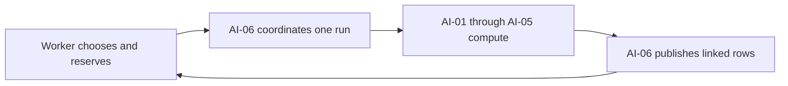

# AI-06 - How the Pipeline Implementation Works

A practical learning guide for Hussein Elhaddad, AI-track owner.

## Start with the problem

You already have five useful pieces of Python: features describe the data, anomaly
detection highlights unusual observations, forecasting projects metrics, recommendation
rules explain problems, and simulation previews bounded actions. Calling each function
in a notebook is useful, but the product needs a repeatable answer to a harder question:
which inputs should these functions use, and when do their results become one saved run?

The orchestrator answers that question. It validates a reserved job, freezes one input
batch, calls the real modules in order, connects their outputs, and saves the complete
result. Its entry point is `run_pipeline(request, *, cancellation)`.

The [technical document](../AI-06-pipeline-orchestrator.md) records exact verification,
contracts and limitations. The [execution plan](../plans/ai-pipeline-execution.md) shows
what was decided before implementation. This guide explains the engineering choices.

## 1. Three responsibilities to keep separate

| Component | Main question | Example responsibility |
|---|---|---|
| Worker | Which job should run, and should it retry? | Claim, reserve run ID, schedule retry, initiate cancellation |
| Orchestrator | How does one valid AI run become a saved result? | Validate, load once, compose, link rows, publish atomically |
| Analytical module | What does this data mean? | Calculate CTR, score anomaly, produce forecast or simulation |

Imagine a kitchen: the Worker chooses the next order, the orchestrator coordinates its
preparation and delivery, and each analytical module performs one specialized operation.
The analogy ends at ownership: AI-06 does not take over job status transitions just
because it can read and lock the jobs table.

The existing Worker executor is still a simulation placeholder. AI-06 implements a
real callable for WORK-04 to connect. Its tests call that callable with valid fixture
claims; they do not pretend the whole background product path is already wired.



**Checkpoint:** Who schedules attempt two after a storage failure? The Worker.
Who inserts the resulting forecast rows? AI-06.

## 2. Job identity and model-run identity

A job is the work ticket. A model run is the analytical audit/result. They have
different IDs because they describe different things. The same logical run ID travels
through every retry of one job.

Suppose job J reserves run R. The Worker commits J.model_run_id=R before calling AI.
AI then creates R and records the request. Every forecast, anomaly and recommendation
from that run gets model_run_id=R. A simulation points to its recommendation; through
that parent we know its campaign, organization and run.

```text
Organization O
    |
    +-- Job J -------- reserves --------> Model run R
    |                                        |
    +-- Campaign C                           +-- Anomaly A
                                             +-- Forecast F
                                             +-- Recommendation K -- source --> A
                                                        |
                                                        +-- Simulation S1
                                                        +-- Simulation S2
                                                        +-- Simulation S3
```

A retry is another attempt to finish R. It is not a new R. Otherwise, a crash could
leave two visible sets of cards for the same work ticket. The stored request also
prevents someone from changing campaign selection or cutoff while reusing R.

## 3. Validate before touching analytical history

The internal request carries organization, job and run IDs, selected campaigns and
as_of. Those values are not automatically trusted because they have UUID types.
AI-06 compares them with PostgreSQL records.

It locks the organization's job briefly and verifies its reserved run. It compares
campaign selection exactly, checks selected-campaign ownership, and verifies that
the job is a valid RUNNING claim within the existing attempt limit. The job's creation
time is converted to UTC before taking its date. A job created at local 01:00 on
22 January in UTC+2 has a fixed cutoff of 21 January UTC.

Every retry uses that same date. Using today's date instead could let later facts
enter a retry, even though the original work ticket requested an earlier analysis.

The run ID is checked for foreign ownership before any full run context is read.
An invalid foreign request returns a safe invalid_input failure. It does not mutate
the foreign run or expose its contents.

**Checkpoint:** Is a valid UUID proof that the campaign belongs to the organization?
No. Ownership is a stored relationship that must be checked.

## 4. Freeze one batch and release the database

The input phase uses a read-only REPEATABLE READ transaction. A transaction groups
related database operations; REPEATABLE READ gives those reads one consistent
snapshot. Campaign selection and the loader's facts therefore agree about the same
committed database view, even if ingestion commits changes during the read phase.

The loader returns immutable MetricRecord objects. AI-06 then closes that Session.
Feature engineering and model fitting happen on those Python records without a
database connection or a job lock held open.

This matters for two reasons. First, every analytical stage sees the same input
batch. Second, a slow forest fit does not prevent the Worker from acquiring the job
row to request cancellation. It also avoids keeping a database transaction idle
through expensive CPU work.

The pipeline reads all authorized history through as_of. A dashboard display range
is a presentation choice and could remove the history required by the models.
The feature scope guard is a second check: even a faulty loader cannot silently
supply foreign, future or duplicate campaign/day records to downstream stages.

## 5. Trace one real synthetic campaign

The evidence procedure ingests 21 campaign days through the real Data ingestion
boundary. The first 20 days each have spend 100, 1,000 impressions, 50 clicks,
5 conversions and revenue 300. On 21 January, spend is 400, clicks 1, conversions 1,
and revenue 1, with impressions still 1,000.

AI-01 calculates these final-day features:

| Feature | Hand calculation | Value |
|---|---|---:|
| CTR | 1 / 1,000 | 0.001 |
| CPC | 400 / 1 | 400 |
| CPA | 400 / 1 | 400 |
| ROAS | 1 / 400 | 0.0025 |
| Conversion trend | (1 - 5) / 5 | -0.8 |
| Seven-day rolling CTR | (6 x 50 + 1) / (7 x 1,000) | 301 / 7,000 |

The final observation is unusual on several features. The actual detector, rather
than an invented fixture score, determines whether it crosses the existing critical
publication gate. In the executed example it produced five published metric-evidence
anomalies. AI-03 produced nine forecasts: three metrics at three horizons. AI-04
produced three cards and AI-05 produced nine simulation rows. Exact run IDs and replay
counts are recorded in the technical document.

The baseline window is 15-21 January: six ordinary days plus the final day. Its totals
are spend `6 x 100 + 400 = 1,000`, conversions `6 x 5 + 1 = 31`, and revenue
`6 x 300 + 1 = 1,801`. The next section explains what those totals mean.

**Checkpoint:** Does 21 source days mean that the baseline adds all 21 days? No. All
history supports analytical modules; the approved simulation baseline uses exactly
as_of-6 through as_of.

## 6. Where structured anomaly evidence comes from

AnomalyResult describes a campaign on a date. Its score combines statistical and
Isolation Forest evidence across several features. That does not mean each metric
has independently received the same score or probability.

Before AI-06, the detector exposed human-readable reasons but not complete direct
metric contributions. Parsing a reason such as 'spend is unusually up' would lose
numeric evidence and confuse performance direction with metric direction.

The implementation extracts a shared per-feature statistical calculation inside the
detector. The same calculated median, robust Z and IQR contribution feed both the
existing aggregate branches and the additive metric_evidence tuple. No detector is
reimplemented in the database layer.

For example, five earlier spend observations of 100 have median 100 and zero median
absolute deviation. The existing floor gives scale 5. Current spend 200 gives
`min(abs(200-100)/(6 x 5),1)=1` for its Z contribution. The IQR floor is also 5,
upper fence 107.5, and `min((200-107.5)/(3 x 5),1)=1`. With only that feature unusual,
the two-feature corroboration rule gives 0.5 to each statistical aggregate, preserving
the original detector behavior.

The adapter persists only qualifying critical campaign diagnostics with changed,
explicit direct-metric evidence. Current > earlier median means above; current <
median means below. A CPA above baseline can represent worse business performance;
that is why 'performance up/down' is not a substitute for metric above/below.

Stored evidence includes the observation date, current value, earlier median,
historical count, Z/IQR contributions and score_scope=campaign_day. detected_at is
observation midnight; created_at is when the row was inserted. Only signals from the
latest available campaign observation may enrich the current cards.

## 7. Why the baseline is seven-day totals

AI-03's horizon-7 point forecast means a value at a future date. It does not mean the
sum across the next seven days. For example, a daily spend forecast of 100 at day 7
is not a weekly budget of 100. With flat daily spend, a weekly total would be 700.

Hussein approved the historical-repeat-v1 MVP policy in this implementation session:
require all seven distinct calendar dates ending at as_of, add spend/conversions/
revenue, and explicitly assume those totals repeat during as_of+1..as_of+7. It is a
transparent heuristic, not validated prediction accuracy. The canonical contract
records the owner decision and its limits.

For the real worked campaign, baseline S=1,000, C=31, R=1,801:

| Scenario | Multiplier | Spend | Expected conversions | CPA | ROAS |
|---|---:|---:|---:|---|---:|
| Budget decrease 20% | 0.80 | 800 | 24.8 | 1,000 / 31 | 1.801 |
| Budget increase 15% | 1.15 | 1,150 | 35.65 | 1,000 / 31 | 1.801 |
| Pause | 0 | 0 | 0 | Unavailable | Unavailable |

AI-05 preserves the proportional arithmetic using Decimal precision 28. Fractional
expected conversions are legitimate. Positive-denominator CPA and ROAS stay constant
because spend, conversions and revenue all scale by the same multiplier. These
previews do not claim that increasing a budget improves efficiency.

A missing date makes the baseline unavailable. Seven observations spread across eight
dates do not satisfy it. A recorded zero-activity day does count as present. Duplicates
fail rather than being summed twice. Without a complete baseline, AI-06 keeps valid
anomalies/forecasts but omits that campaign's cards/simulations, returns the supported
insufficient_history warning and stores the affected campaign/window/rules in metadata.

## 8. How Python objects become linked rows

Before persistence, a Recommendation has no database ID. It has organization_id,
campaign_id and rule_id, plus explanation text and scores. The simulator returns
batches with the same correlation key.

AI-06 indexes batches by `(organization_id, campaign_id, rule_id)`. For each card it
allocates an ID, finds that card's batch by key, and builds three simulation rows
whose recommendation_id is the allocated ID. It also allocates anomaly IDs before
recommendation generation, so AI-04 can retain a matching source_anomaly_id.

This avoids a subtle bug: simulator output and recommendation output can have
different sort orders. 'The third simulation batch belongs to the third card' is
not a valid relationship. Names are also unsafe because different campaigns can
have identical names. IDs plus rule identity survive ordering and naming changes.

The original evidence strings remain in an array. New strings append rule identity,
all simulation assumptions, and each scenario's undefined ratio markers. New cards
start pending. AI never updates an existing human-approved or rejected status.

The Core table definitions are query handles. SQLAlchemy turns INSERT expressions
and bound values into database operations. Alembic migrations, rather than these
handles, remain the authority that creates and evolves the actual schema.

## 9. Session, lock, commit and rollback

A Session is a unit of database work. A transaction has a beginning and either commits
or rolls back. Commit makes the writes durable and visible together. Rollback abandons
the transaction's writes. A row lock makes competing transactions wait before changing
or locking the same row.

AI-06 uses several short transactions with computation between them:

```text
T1: lock job -> validate/register run -> COMMIT
T2: read-only consistent campaign/fact batch -> CLOSE
    compute features, detect, forecast, recommend, simulate
T3: lock job -> recheck run/claim/cancellation
    insert linked outputs -> set SUCCESS -> COMMIT
On unexpected failure: separate T4 saves safe FAILED or CANCELLED
```

Why not commit each campaign separately? A later campaign might fail, leaving some
cards visible from a run reported as failed. The approved whole-run protocol avoids
that ambiguity. All outputs and SUCCESS commit together. If even the final simulation
insert fails, the earlier output inserts in T3 roll back as well.

Why add execution_metadata? The old run row could count analyzed campaigns but could
not remember the exact warnings, omissions or claim identity. One nullable JSONB
column stores the original request/claim and final outcome. The successor migration
adds it without rewriting historical migrations or changing existing array fields.
Legacy rows with no context are rejected for replay instead of having history invented.

## 10. Replay and the post-commit crash

Consider two possible crash locations:

1. Crash before T3 commits: PostgreSQL rolls back its incomplete output transaction.
   Worker recovery must reconcile the run and serialize any eligible retry.
2. Crash after T3 commits but before the Worker marks the job SUCCESS: all outputs and
   the run's SUCCESS already exist. Calling the same request returns that saved outcome.

The second case is easy to overlook. Looking only at jobs.status would suggest work
is unfinished and could produce duplicate cards. AI-06 first inspects model_runs.
A stored SUCCESS bypasses loading and computation; it never inserts again.

There is also a second check under the publication lock. Two callers could both pass
registration before either commits output. They compute independently, then compete
for the job lock. The first publishes. The second acquires the lock, re-reads SUCCESS
and returns it. An earlier optimistic check alone cannot prevent this race.

Tests compare complete saved rows before and after replay, not just counts. They
also approve existing cards before replay and verify that the human decisions remain.
This is idempotent publication under the specified protocol, not a universal promise
of distributed exactly-once execution or solved stale-worker lease recovery.

**Checkpoint:** Why is 'check SUCCESS before computing' insufficient by itself?
Because another caller can commit SUCCESS after that check and before this caller publishes.

## 11. Cancellation racing with publication

The callback answers 'has cancellation been observed?' It does not write jobs. Worker
control must perform authorized cancellation using its own short, tenant-scoped Session.
AI checks before/after stages, between campaigns and immediately before publication.
An active sklearn fit cannot be interrupted by these checkpoints; it may finish first.

Cancellation and publication use the same job row lock:

```text
Cancellation locks and commits first:
    job becomes CANCELLED -> publisher sees it -> no outputs -> run CANCELLED

Publication locks and commits first:
    outputs + run SUCCESS -> cancellation reads SUCCESS -> completed result wins
```

The race tests coordinate real PostgreSQL transactions with Events and Barriers. One
holds the job lock while the other attempts the conflicting action. They establish
ordering directly instead of hoping that a sleep makes one thread faster.
Each thread creates its own Session. A Session contains mutable transaction state;
sharing it across threads can mix operations and invalidate the very race being tested.

## 12. Missing is different from zero

A measured spend of zero is data. Missing spend history is lack of data. An undefined
ratio is neither a successful measurement nor a missing source observation.

AI-03 explicitly marks insufficient-history forecasts with no numeric value. AI-06
omits them and reports insufficient_history. It does not invent a zero prediction.
The existing forecasting contract permits negative ROAS projections from some models;
the persistence adapter retains those rather than silently changing model meaning.

AI-05's table has NOT NULL CPA/ROAS columns, so unavailable ratios use a numeric-zero
sentinel plus an explicit marker stored in the parent evidence. Pause has both markers.
A non-pause scenario with zero expected conversions has an unavailable CPA marker too.
By contrast, zero spend divided by positive conversions gives a legitimate measured
zero CPA. API-05 must read the markers to present these different states correctly.

## 13. Failures and a later retry

Invalid identities, duplicate inputs and malformed metric evidence produce safe,
nonretryable invalid_input outcomes. Unexpected computation failures and storage
failures have separate codes. The code records only safe codes, not exceptions,
SQL text, credentials, provider responses or tracebacks.

A failed publication rolls back first. A separate short transaction then saves FAILED.
If even that cannot reach the database, the error escapes to Worker recovery. Returning
'a durable failure was saved' in that situation would be false.

To restart a FAILED row, Worker must supply a later eligible claim: increased
retry_count below the existing cap, later claimed_at, RUNNING state and a due retry
schedule. The original request and logical run ID stay the same; started_at is retained.
CANCELLED stays terminal. Calling a FAILED run again with the same claim is rejected.

## 14. Read the code in this order

| Order | File or function | What to look for |
|---|---|---|
| 1 | ai/contracts.py | Request/outcome, errors and warnings |
| 2 | ai/integration.py | Scope checks, anomaly adapter, usable forecast filter |
| 3 | ai/pipeline.py: run_pipeline | The overall success/error path |
| 4 | ai/persistence.py: register, lock_job | Stored identity and claim checks |
| 5 | pipeline.py: _load, _compute | Fixed input and real module composition |
| 6 | pipeline.py: prepare_baseline | Approved exact calendar-week rule |
| 7 | anomaly/detector.py: _feature_statistics | Shared original statistics and metric evidence |
| 8 | pipeline.py: _publish; persistence.save_outcome | Lock, replay check, atomic output commit |
| 9 | tests/integration/ai/test_pipeline.py | Actual PostgreSQL behavior and fault/race evidence |
| 10 | scripts/ai06_evidence.py | Reproducible persisted demonstration |

These paths are relative to apps/backend/src/sawakli unless a tests/scripts prefix
is present. Repository links and exact commands are in the technical document.

## 15. Patterns used, without extra frameworks

An **application service** coordinates one use case: execute a valid AI request.
A **functional core with an imperative shell** keeps database effects around pure
analytical functions. An **adapter** converts one truthful representation into another,
such as diagnostic plus metric evidence into a persistable signal. A **unit of work**
is the SQLAlchemy transaction that commits the complete result. **Idempotency** means
repeating the same successful request preserves the already-published result.

These are names for concrete code decisions, not reasons to introduce a workflow
framework. The useful separation lets you test formulas without a database, then
prove identity, locking and atomicity against real PostgreSQL.

## 16. What the tests prove

| Test group | Engineering claim it checks |
|---|---|
| Baseline unit cases | Exact dates, measured zero days, no duplicate sums, tenant scope and deterministic totals |
| Detector formulas/equivalence/benchmark | Evidence exposure preserves original scores, reasons and quality gates |
| Real-chain PostgreSQL case | Actual modules produce linked persisted rows and three scenarios per card |
| Foreign-input cases | IDs cannot cross organization/job/run/campaign boundaries |
| Read-only snapshot test | One consistent batch; no connection held during computation |
| Fault injection after INSERTs | Unexpected failure leaves no partial output |
| Retry and outage cases | Safe failure state, eligible retry only, no fabricated durable outcome |
| Replay/human decision/crash case | No recomputation, duplicate rows or reset decisions |
| Barrier/event races | Publication rechecks success and serializes with cancellation |

These tests do not prove that a heuristic will improve real advertising results.
They prove implementation behavior. Benchmark quality is limited to the declared
reference data and operating point; historical Nour labels remain unavailable.

## 17. What remains outside AI-06

WORK-04 still connects the callable to production claiming/dispatch, reserves run IDs,
serializes retries, initiates cancellation and reconciles committed runs after timeout.
API-05 serves the saved results and interprets missing/undefined states. AI-07 and QA
own broader security acceptance. Runtime least-privilege credentials and RLS rollout
remain separate work under ADR 0001. FUT-04 covers stale-lease recovery.

Affected-owner review, final CI acceptance and merge remain required before task
completion. ADR 0002 remains prepared for review. This guide records implementation
and executed evidence without claiming those approvals.

## Glossary

| Term | Plain meaning |
|---|---|
| as_of | Fixed last permitted observation date |
| Canonical facts | Normalized marketing records owned by Data |
| Correlation key | IDs and rule identity used to match a card with its simulation batch |
| Foreign key | Database relationship requiring the referenced parent row to exist |
| Atomic publication | All run outputs and SUCCESS commit together, or none do |
| Replay | Repeating a request and returning the saved successful/terminal outcome |
| Snapshot | One consistent view of committed facts for the read transaction |
| Sentinel | Stored placeholder that needs a marker to distinguish unavailable from zero |
| Cooperative cancellation | Stop at explicit checks, after an active calculation can return |

## Final understanding checks

- If one of the last seven calendar dates is absent, what survives? Independently valid
  forecasts/anomalies; the campaign's cards/simulations are omitted with traceable warning details.
- If a simulation INSERT fails after cards were inserted, are those cards visible? No;
  the whole publication transaction rolls back.
- If the Worker crashes after AI commits SUCCESS, should it allocate a new run ID? No;
  reconcile and replay the reserved logical run.
- If two callers passed the first check, what prevents duplicate publication? Re-reading
  SUCCESS after acquiring the shared job-row lock.
- Does a pause projection's CPA=0 mean free acquisition? No; its cpa marker means unavailable.

[Technical verification and stored example](../AI-06-pipeline-orchestrator.md#14-verification)
contains actual results and delivery links. Shared rules live in the
[canonical pipeline contract](../../contracts/ai-pipeline-and-persistence.md).
