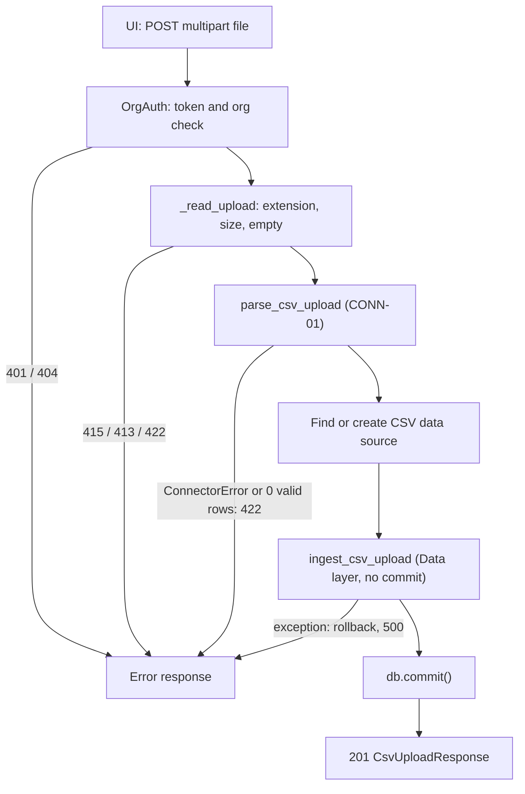

# API-03 (CSV part) — CSV Upload Endpoint

## 1. Overview

This task adds one backend endpoint, `POST /orgs/{org}/data-sources/csv`. The UI sends a CSV file
to it. The endpoint checks that the caller is signed in and belongs to the organization, checks
the file, parses it with the Connector layer's CSV parser, saves the result through the Data
layer's ingestion service, and returns a short summary.

It exists so a team can load campaign data from a CSV file before a real Google or Meta account is
connected. For this project, CSV upload is a development simulation, not a production data path.

It sits between the UI and the Data layer. The Connector layer (CONN-01) only turns a file into
rows. The Data layer owns the database tables and how rows become campaigns and metrics. This
endpoint connects them and owns the HTTP behavior and the transaction.

## 2. Scope

### In Scope

- The `POST /orgs/{org}/data-sources/csv` endpoint.
- Upload checks: `.csv` extension, empty file, size limit (configurable).
- Mapping parser errors to HTTP 422 responses.
- Finding or creating the organization's CSV data source (one per organization, reused).
- Calling the existing ingestion service and committing the transaction.
- Request and response schemas for the endpoint.
- SQLAlchemy models that were missing: `DataSource`, `GaEvent`, `RawApiResponse`.
- Tests for the endpoint.

### Out of Scope

- OAuth connect and callback endpoints (a separate later piece of API-03).
- Demo data loading (seeded by a migration, not through the parser).
- The CSV parser, `ConnectorError`, `deps.py`, `session.py`, auth routes, and the database
  schema and migrations. These belong to other tasks and were not modified.
- Duplicate detection, normalization and upserting. These belong to the Data layer.
- Any change to row-level security (RLS) setup in `get_db` or `deps.py`.

## 3. Prerequisites

| Task / Contract | Why Required |
|---|---|
| CONN-01 — CSV parser | `parse_csv_upload` turns the uploaded bytes into rows, warnings, or a `ConnectorError`. |
| DATA-01 — Schema and migrations | Defines `data_sources`, `raw_api_responses`, `campaigns`, `daily_metrics`, `ga_events` and their enums. |
| PROD-01 — CSV template | Defines the 10 CSV columns (8 required) that the parser accepts. |
| Auth and org scoping (`deps.py`, login routes) | Provides `OrgAuth`, `DbSession` and `apply_org_scope`. |
| Data ingestion service (`sawakli/data/ingestion/service.py`) | Saves a parsed upload. Its docstring cites ARCH-04 and the raw-response-canonical-handoff contract. |

Canonical contracts and ADRs: the raw-response-canonical-handoff contract and ARCH-04 (named in
the ingestion service). Their text was not available while writing this document, so behavior
described here was verified against the code, not the contract text.

## 4. Architecture

```text
UI (multipart file)
↓
POST /orgs/{org}/data-sources/csv   ← this task (HTTP, checks, transaction)
↓
parse_csv_upload                    ← CONN-01 (pure function, no DB)
↓
ingest_csv_upload                   ← Data layer (writes to the DB, does not commit)
↓
PostgreSQL tables
```

Ownership boundaries:

- **Connector layer** never writes to the database.
- **This endpoint** owns authentication, file checks, the data source lookup and creation, and
  `commit()` / `rollback()`.
- **Data layer** owns raw copies, campaigns, daily metrics, sessions and bounces, and
  `data_sources.status`, `sync_status` and `last_synced_at` after a successful ingest.

## 5. Step-by-Step Implementation Walkthrough

### Practical Outcome

After this task, a signed-in user can upload a CSV file for their organization and get back a
summary. Their campaigns, daily metrics and sessions and bounces data are then in the database
and available to the rest of the platform. For example, uploading a file with 3 rows for 2
campaigns creates 2 campaigns and 3 days of metrics. Uploading it again with a changed number
replaces the old number instead of adding a duplicate.

If the file is bad, the user gets a clear message instead of a crash. A file with one bad row
still succeeds, and the response lists a warning for the skipped row.

This is implemented and tested. Items that were not verified are labeled in Section 14 and
Section 15.

### Acceptance Criteria → Steps and Evidence

The approved task text was not available as a separate document. These criteria come from the API-03
CSV task brief.

| Acceptance Criterion | Implementation Step(s) | Verification Evidence / Status |
|---|---|---|
| Auth and org check: no token gives 401, `{org}` not matching the token gives 404 | 4 | `test_no_token_returns_401`, `test_org_not_matching_token_returns_404` — PASS |
| Data source: create or reuse decided with the student | 7 | Decision: reuse one `csv_demo` data source per org. Integration test checks the second upload returns the same id — PASS |
| Validate before parsing: multipart field, `.csv`, not empty, size cap in config, 413/415/422 | 1, 5 | `test_missing_file_field_returns_422`, `test_wrong_file_type_returns_415`, `test_file_too_large_returns_413`, `test_empty_file_returns_422` — PASS. Content type is not checked, only the extension (Step 5) |
| Call `parse_csv_upload`; no CSV parsing in the route | 6 | `test_one_bad_row_still_succeeds_with_warning` — PASS |
| `ConnectorError` gives 422 with `{code, user_message, retryable}`, log `message` only | 6 | `test_invalid_header_returns_422`, `test_non_utf8_file_returns_422` — PASS. Log content reviewed in code only, no automated check |
| `row_count == 0` gives 422 `no_valid_rows` with warnings | 6 | `test_all_rows_bad_returns_no_valid_rows` — PASS |
| Persist rows through the existing ingestion service | 7, 8 | `test_valid_file_is_saved_and_reupload_updates` — PASS |
| Response has data source id, `row_count`, `parse_warnings`, status | 9 | `test_one_bad_row_still_succeeds_with_warning` and the integration test — PASS |
| Org always comes from the token; no secrets in responses or logs | 4, 6, 8 | `test_ingest_gets_org_from_token_and_parsed_rows` and the `message` check in `test_invalid_header_returns_422` — PASS. Logging reviewed in code only (see Section 15) |
| Tests from the brief: 401, 404, wrong type, too large, empty, invalid header, non-UTF-8, one bad row, all bad, BOM, persisted rows | 10 | `test_file_with_bom_succeeds` and the tests above — PASS |
| Do not change the parser, `errors.py`, `deps.py` or the DB schema | all | No edits to these files were made as part of this work. NOT VERIFIED — confirm in the PR diff |

### Step 1 — Add the upload size setting

- **What:** Adds a configurable maximum upload size so the limit is not hardcoded in the route.
- **Where:** `sawakli/core/config.py`, class `Settings`, field `csv_max_upload_bytes` (default
  `5 * 1024 * 1024`, which is 5 MB). It can be overridden with `CSV_MAX_UPLOAD_BYTES` in `.env`.
- **How it works:** The route reads `settings.csv_max_upload_bytes` on every request.
- **Testing:** `test_file_too_large_returns_413` lowers the value to 50 bytes and expects 413.
  Status: PASS (see Section 14).

### Step 2 — Add the missing database models

- **What:** The Data layer reads and writes tables with raw SQL, so the endpoint's data source
  lookup needed an ORM model that did not exist yet.
- **Where:**
  - `sawakli/db/models/data_source.py`: `DataSource`, plus the enums `Provider`,
    `DataSourceStatus` and `SyncStatus`.
  - `sawakli/db/models/ga_event.py`: `GaEvent`.
  - `sawakli/db/models/raw_api_response.py`: `RawApiResponse`.
  - `sawakli/db/models/campaign.py`: `data_source_id` now has `ForeignKey("data_sources.id")`.
    This edit was made on the student's instruction. Confirm it in the PR diff.
- **How it works:** Each model maps one table from the DATA-01 schema. Enum types use
  `create_type=False`, because the migrations already create them. `Provider` includes
  `csv_demo`, which is the only CSV-like provider value in the schema.
- **Testing:** `DataSource` is exercised by the integration test. `GaEvent` and `RawApiResponse`
  are not used by this endpoint, because the ingestion service writes those tables with its own
  SQL. Status for those two: NOT RUN — not used by this endpoint.

### Step 3 — Add request and response schemas

- **What:** Defines the JSON shapes the endpoint returns.
- **Where:** `sawakli/api/schemas/data_source.py`: `CsvUploadResponse` and `UploadError`.
- **How it works:** `CsvUploadResponse` holds `data_source_id`, `row_count`, `parse_warnings`
  and `status`. `UploadError` holds `code`, `user_message`, `retryable` and an optional
  `parse_warnings` (used only for `no_valid_rows`).
- **Testing:** Covered through the route tests, which check response bodies. Status: PASS.

### Step 4 — Authenticate and match the organization

- **What:** Makes sure only a signed-in member of the organization can upload.
- **Where:** `sawakli/api/routes/data_sources.py`, function `upload_csv`, parameter
  `auth: OrgAuth`.
- **How it works:** `OrgAuth` (from `deps.py`) decodes the Bearer token and checks that the user,
  organization and membership exist (otherwise 401). It then checks that `{org}` in the URL equals
  the token's organization (otherwise 404). The route uses `auth.organization.id` for everything
  after this and never reads an organization id from user input.
- **Testing:** `test_no_token_returns_401`, `test_org_not_matching_token_returns_404`,
  `test_ingest_gets_org_from_token_and_parsed_rows`. Status: PASS.

### Step 5 — Check the file before parsing

- **What:** Rejects bad uploads early and cheaply.
- **Where:** `_read_upload(file)` in `data_sources.py`.
- **How it works:**
  1. The file name must end in `.csv`, otherwise 415 `unsupported_file_type`. Content type is not
     checked, because browsers send inconsistent content types for CSV files.
  2. The function reads at most `csv_max_upload_bytes + 1` bytes. If it gets more than the limit,
     it returns 413 `file_too_large`. This way a huge file is never fully loaded into memory.
  3. A file with zero bytes returns 422 `empty_file`.
  4. Otherwise it returns the bytes.
- **Testing:** `test_wrong_file_type_returns_415`, `test_file_too_large_returns_413`,
  `test_empty_file_returns_422`. Status: PASS.

### Step 6 — Parse and map failures

- **What:** Turns the file into rows, and turns parser failures into HTTP errors.
- **Where:** `upload_csv` in `data_sources.py`, calling `parse_csv_upload` from CONN-01, and the
  helper `_error(...)`.
- **How it works:** The route calls `parse_csv_upload(io.BytesIO(data), organization_id, upload_id)`.
  The route is a plain `def`, so FastAPI already runs it in a thread pool and the call can be direct.
  - If the result is a `ConnectorError`: the internal `message` is logged as a warning, and the
    response is 422 with `code` (the error kind), `user_message` and `retryable`.
  - If the result has `row_count == 0`: 422 `no_valid_rows`, with `parse_warnings`.
  - Otherwise processing continues. Rows the parser skipped appear in `parse_warnings`.
  - `_error` builds every error body in the same shape.
- **Testing:** `test_invalid_header_returns_422`, `test_non_utf8_file_returns_422`,
  `test_all_rows_bad_returns_no_valid_rows`, `test_one_bad_row_still_succeeds_with_warning`,
  `test_file_with_bom_succeeds`. Status: PASS.

### Step 7 — Find or create the CSV data source

- **What:** The ingestion service needs a data source id. This step provides one.
- **Where:** `_get_or_create_csv_data_source(db, organization_id)` in `data_sources.py`.
- **How it works:** It selects the organization's data source with provider `csv_demo`, using
  `apply_org_scope`. If none exists, it creates one with status `demo_data` and calls `flush()`.
  The flush is required because the session has autoflush turned off, and the ingestion service
  later updates this row with raw SQL.
- **Testing:** `test_valid_file_is_saved_and_reupload_updates` checks that two uploads give the
  same `data_source_id` and exactly one data source row. Status: PASS.

### Step 8 — Save the rows and commit

- **What:** Writes everything to the database in one transaction.
- **Where:** `upload_csv` calls `ingest_csv_upload` (`sawakli/data/ingestion/service.py`). That
  service uses `sawakli/data/staging/` (`adapters.py`, `models.py`),
  `sawakli/data/validation/mappings.py` and `sawakli/data/normalization/` (`normalize.py`,
  `payloads.py`, `pipeline.py`, `upsert.py`).
- **How it works:**
  1. The route passes the parsed result, the org id, the data source id, a new `upload_id`
     (`uuid4()`), the label `"csv_upload"`, a raw payload `{"row_count", "parsed_rows"}`, and the
     current UTC time.
  2. The service inserts a raw copy into `raw_api_responses`. It does nothing if the same
     `upload_id` already exists.
  3. Each parsed row becomes a staged row, is cleaned, and is saved with an "insert or update"
     statement into `campaigns`, `daily_metrics` and `ga_events`.
  4. The service sets the data source to status `demo_data`, `sync_status` `success`, sets
     `last_synced_at`, and clears `last_error`.
  5. The service does not commit. The route calls `db.commit()` once. If anything raises, the
     route calls `db.rollback()`, logs the exception, and returns 500 `ingest_failed` with
     `retryable: true`. Nothing is half saved.
- **Testing:** `test_valid_file_is_saved_and_reupload_updates` (real database),
  `test_save_failure_rolls_back_and_hides_details`,
  `test_ingest_gets_org_from_token_and_parsed_rows`. Status: PASS.

### Step 9 — Return the summary

- **What:** Tells the UI what happened.
- **Where:** End of `upload_csv`, response model `CsvUploadResponse`, HTTP 201.
- **How it works:** After the commit, SQLAlchemy reloads the data source, so `status` is the value
  the ingestion service set. `row_count` is the number of valid parsed rows.
- **Testing:** `test_one_bad_row_still_succeeds_with_warning` and the integration test check the
  body. Status: PASS.

### Step 10 — Write the tests

- **What:** Proves the behavior above.
- **Where:** `apps/backend/tests/unit/api/test_csv_upload_route.py` (13 tests, no real database)
  and `apps/backend/tests/integration/api/test_csv_upload_db.py` (1 test, real database).
- **How it works:** The unit tests fake authentication, the DB session and the saving step. The
  integration test creates a temporary organization, fakes only the login, uploads through the
  real route and database, checks table counts and one value, then deletes the organization.
  Every other table cascades from `organizations`, so nothing is left behind.
- **Testing:** See Section 13 and Section 14.

### Flow Diagram



## 6. Inputs

| Field / Input | Type | Required | Source | Description |
|---|---|---|---|---|
| `Authorization: Bearer <JWT>` | header | Yes | UI | Identifies the user and organization. Missing or invalid gives 401. |
| `org` | UUID (path) | Yes | URL | Must equal the organization in the token. Checked, never trusted. A mismatch gives 404. |
| `file` | multipart file | Yes | UI | A `.csv` file, UTF-8 (a BOM is accepted). A missing field gives FastAPI's standard 422. |
| `csv_max_upload_bytes` | int (setting) | No | `Settings` / `.env` | Maximum size in bytes. Default 5 MB. |

Validation: the file name must end in `.csv` (case-insensitive), the file must not be empty, and it
must not exceed the size limit. Column and row rules belong to the parser (see PROD-01).
Organization scope: always `auth.organization.id` from the token. No organization id is accepted
from the request body.

## 7. Outputs

Success response, HTTP 201:

| Field / Output | Type | Nullable | Consumer | Description |
|---|---|---|---|---|
| `data_source_id` | UUID | No | UI | The organization's CSV data source. Same id on every upload. |
| `row_count` | int | No | UI | Number of valid rows the parser accepted. It counts repeated rows in the file separately. |
| `parse_warnings` | list of string | No (can be empty) | UI | One entry per skipped row, for example `Row 3: 'spend' is negative (-5)`. |
| `status` | string | No | UI | Data source status after the upload. Currently `demo_data`. |

Error response, HTTP 413, 415, 422 and 500, body `{"detail": {...}}`:

| Field / Output | Type | Nullable | Consumer | Description |
|---|---|---|---|---|
| `code` | string | No | UI | Error code (see Section 9). |
| `user_message` | string | No | UI | Safe text to show to the user. |
| `retryable` | bool | No | UI | Whether trying again can help. |
| `parse_warnings` | list of string | Yes | UI | Present only for `no_valid_rows`. |

401 and 404 use FastAPI's plain shape, `{"detail": "Not authenticated"}` and
`{"detail": "Not found"}`. A missing `file` field returns FastAPI's standard validation error.

## 8. Rules and Semantics

CSV column and row rules are defined by PROD-01 and implemented by the parser, so they are not
repeated here. In short: bad rows are skipped with a warning, and the file is rejected only when
nothing can be used.

Rules added by this endpoint:

- **Size limit:** a file of exactly `csv_max_upload_bytes` bytes is accepted. One byte more is
  rejected with 413. The route reads at most `limit + 1` bytes.
- **Data source:** one data source per organization with provider `csv_demo`. It is created on
  the first upload and reused after that.
- **Status:** a new data source is created as `demo_data`. After a successful ingest the Data
  layer sets `demo_data`, `sync_status` `success`, `last_synced_at` to the upload time, and clears
  `last_error`. A failed upload rolls back and records nothing.
- **Duplicates and re-uploads:** the ingestion service saves each row with "insert or update".
  - A campaign is matched by data source, name and platform (CSV rows have no external id).
    Matching is exact, so `Spring Sale` and `spring sale` are different campaigns.
  - A daily metric and a sessions and bounces row are matched by campaign and date.
  - Uploading the same campaign and date again replaces the old values.
- **Ordering:** rows are processed in file order. If the same campaign, platform and date appears
  twice in one file, the later row wins. This follows from the code, and the integration test
  covers re-uploads across files, not repeats inside one file.
- **Sessions and bounces:** a `ga_events` row is written for every CSV row. Missing values are 0
  (parser default), and `session_duration` is null.
- **Atomicity:** the data source creation, raw copy, canonical writes and status update happen in
  one transaction. The route commits once at the end.
- **Missing values and zero denominators:** not applicable here. The endpoint calculates nothing.
  Zero values are accepted, since the parser rejects only negative numbers.

## 9. Public Interfaces

### `POST /orgs/{org}/data-sources/csv`

- **Input:** multipart form with field `file`; Bearer token; `org` path UUID.
- **Output:** 201 with the success body from Section 7.
- **Errors:**

| Status | `code` | When |
|---|---|---|
| 401 | (plain detail) | No token, bad token, or user, organization or membership not found |
| 404 | (plain detail) | `{org}` does not match the token's organization |
| 413 | `file_too_large` | File is over the size limit |
| 415 | `unsupported_file_type` | File name does not end in `.csv` |
| 422 | `empty_file` | Zero bytes, only whitespace, or a header with no data rows |
| 422 | `invalid_header` | A required column is missing |
| 422 | `unreadable_encoding` | The file is not valid UTF-8 |
| 422 | `no_valid_rows` | The file parsed, but every row was bad. Includes `parse_warnings` |
| 422 | (FastAPI validation) | The `file` field is missing |
| 500 | `ingest_failed` | Saving failed. Everything was rolled back. `retryable` is true |

- **Side effects:** on success, creates the CSV data source if needed, and writes to
  `raw_api_responses`, `campaigns`, `daily_metrics`, `ga_events` and `data_sources`.

### Database reads and writes by this endpoint

See Section 10.

## 10. Data Ownership

### Reads

- `users`, `organizations`, `organization_members` — through `get_auth_context` in `deps.py`.
- `data_sources` — the lookup of the organization's `csv_demo` row, scoped with `apply_org_scope`.

### Writes

- `data_sources` — the route inserts a new row on the first upload. The ingestion service then
  updates `status`, `sync_status`, `last_synced_at` and `last_error`.
- `raw_api_responses`, `campaigns`, `daily_metrics`, `ga_events` — written only by the ingestion
  service, never by the route directly.

### Must Never Read

- Any row that belongs to another organization.
- Organization ids from user-supplied input.

### Must Never Write

- Anything from the parser. The Connector layer never writes to the database.
- The schema or migrations.
- `oauth_connections` and `connector_tokens`. These belong to the later OAuth work.

## 11. Security

- **Organization isolation:** the organization id comes only from the signed token.
  `require_org_match` rejects a mismatched URL with 404. Every route query on org data uses
  `apply_org_scope`. The ingestion service sets the RLS context (`app.current_org_id`) inside each
  upsert and scopes its status update by organization.
- **Authentication:** the Bearer token is validated by the existing `get_auth_context`.
- **Untrusted input:** `campaign_name` is free text. It is passed to the database as bound
  parameters and stored as JSON in the raw copy. It is never built into SQL text.
- **Information leaks:** the parser's internal `message` is logged only and never returned. The 500
  response is generic. The 401 and 404 responses reveal nothing about other organizations.
- **No secrets** are stored, logged or returned by this endpoint.
- **File handling:** the upload is read into memory, up to the size limit. It is never written to
  disk.
- **RLS note:** the data source lookup and creation run before the ingestion service sets
  `app.current_org_id`. This works in development because the default database user is
  `postgres`, which bypasses RLS. See Section 15.

## 12. Error and Edge-Case Behavior

| Case | Expected Behavior |
|---|---|
| Missing token or `file` field | 401 for a missing token. FastAPI's standard 422 for a missing `file` field. |
| Malformed input | Wrong extension gives 415. Bad header gives 422 `invalid_header`. Bad encoding gives 422 `unreadable_encoding`. A bad row is skipped with a warning. |
| Zero values | Accepted. Only negative numbers are rejected, by the parser. |
| Insufficient data | A header with no data rows gives 422 `empty_file`. Every row bad gives 422 `no_valid_rows`. |
| Duplicate records | Replaced by the latest values (Section 8). Duplicates are not reported as warnings. |
| Database failure | Rollback, log the exception, return 500 `ingest_failed` with `retryable: true`. |
| Provider or API failure | N/A — the endpoint makes no external calls. |
| Timeout | No timeout is set by this endpoint. It relies on the server and database defaults. |
| Cancellation | Not handled specifically. Nothing is committed unless the request reaches `db.commit()`. Uncommitted work is discarded when the session closes. |
| Concurrent first uploads | Not guarded. Two simultaneous first uploads for one organization could create two CSV data sources. See Section 15. |

## 13. Testing

### Unit Tests

File: `apps/backend/tests/unit/api/test_csv_upload_route.py`. No real database. Authentication,
the DB session and the saving step are faked, so the tests check only what the route does.

- Auth: no token gives 401. A URL org different from the token's gives 404.
- Upload checks: missing `file` field gives 422. `.txt` gives 415. A file over the limit gives 413
  (limit lowered to 50 bytes in the test). An empty file gives 422 `empty_file`. In every error
  case the test also checks the saving step was never called.
- Parser errors: missing columns give 422 `invalid_header`, `retryable` is false, and no internal
  `message` field appears. Non-UTF-8 bytes give 422 `unreadable_encoding`. All rows bad gives 422
  `no_valid_rows` with one warning.
- Success: a file with one good and one bad row gives 201, `row_count` 1, one warning that
  mentions "Row 3", status `demo_data`, one `commit()` call. A file with a BOM succeeds. The
  saving step receives the organization id from the token, the data source id and the parsed
  rows.
- Failure: if saving raises an error, the response is 500 `ingest_failed`, the error text is not
  in the response, `rollback()` is called once and `commit()` is not called.

### Integration Tests

File: `apps/backend/tests/integration/api/test_csv_upload_db.py`. Uses the development database.
It creates a temporary organization and deletes it afterwards. It is skipped if the database is
not reachable. Only the login is faked.

- Uploads 3 rows for 2 campaigns and checks: 1 data source, 2 campaigns, 3 daily metrics, 3
  sessions and bounces rows, 1 raw copy, status `demo_data`, and spend `10.5` for one campaign and day.
- Uploads again with one changed number and checks: the same data source id, still 1 data source,
  2 campaigns and 3 daily metrics, and the changed value replaced the old one.

### E2E Impact

- The UI upload form must send the file in a multipart field named `file`, and read errors from
  `detail.code` and `detail.user_message` (not from a top-level field).
- No UI or end-to-end test exists yet for this endpoint.

## 14. Verification

Commands executed (from `apps/backend/tests`):

```bash
pytest unit/api/test_csv_upload_route.py
pytest integration/api/test_csv_upload_db.py
```

Results:

- `pytest unit/api/test_csv_upload_route.py`, 2026-11-20, developer's Windows machine
  (Python 3.12.10, pytest 8.4.2): 13 tests, 13 passed. One warning, a deprecation notice from
  Starlette's test client, unrelated to this code.
- `pytest integration/api/test_csv_upload_db.py`, first run, same machine: 1 skipped after about
  4 minutes 20 seconds, because the database was not running. This checked nothing.
- `pytest integration/api/test_csv_upload_db.py`, second run after starting the local database:
  1 test, 1 passed in 1.15 seconds.
- CI run or pull request evidence: NOT AVAILABLE — no CI run or PR link was provided.
- Manual upload through the real running application with a real login token: NOT RUN.
- Registration of the router in the main app: NOT VERIFIED. The tests build their own small app,
  so they do not prove the real app includes the route.
- Linting and type checking: NOT RUN.

## 15. Known Limitations

- **RLS context:** the route looks up and creates the data source before the ingestion service
  sets `app.current_org_id`. This works in development because the database user is `postgres`.
  It would fail with a non-superuser database role under RLS. This needs fixing before production.
- **Status value:** the Data layer sets `demo_data` for every CSV upload. The earlier plan was
  `connected`. This may need to change once the real data flow is defined.
- **Provider value:** the schema has no `csv` provider, so uploads use `csv_demo`.
- **File type check:** only the file extension is checked, not the content type or the file's
  contents.
- **Memory and storage:** the whole file (up to 5 MB) is held in memory. The raw copy stores all
  parsed rows again as JSON, so each upload roughly doubles its storage.
- **Duplicates:** repeated rows inside one file are resolved silently (the last wins) and are not
  reported as warnings. Only the cross-file case is tested.
- **Failed uploads** are not recorded on the data source. A rollback leaves `sync_status` and
  `last_error` unchanged.
- **Concurrency:** two simultaneous first uploads for one organization could create two CSV data
  sources.
- **Logging:** the route does not log file contents or cell values at info level. The error log
  for a failed save (`logger.exception`) could include database error details, and those can
  include values from the file. Log contents are checked by code review only, not by tests.
- **Scale:** CSV upload is a development simulation, so large files and high volume were not
  design goals.
- **Unused models:** `GaEvent` and `RawApiResponse` were added for completeness. The ingestion
  service does not use them.
- **PR diff checks:** confirm that `campaign.py` has the new foreign key and that the parser,
  `errors.py`, `deps.py` and the schema are untouched.

## 16. Follow-Up Tasks

No task IDs were available, so these are listed by need.

- `TBD` — Backend — Register the router in the main app and do one manual upload through
  `/docs` with a real token. Required to complete this task.
- `TBD` — Backend and Data — Set the RLS context before the data source lookup, or move the
  lookup into the Data layer, before using a non-superuser database role.
- `TBD` — Product and Data — Decide the final data source status for CSV uploads (`demo_data` or
  `connected`).
- `TBD` — Backend — OAuth connect and callback endpoints (the other part of API-03).
- `TBD` — Backend — Demo data load endpoint.
- `TBD` — QA — Add a test for repeated rows inside one file, and a UI end-to-end test for the
  upload form.

## 17. References and Evidence

- Notion task: not provided.
- Pull request: not provided.
- Canonical contracts: raw-response-canonical-handoff contract and ARCH-04 (named in
  `sawakli/data/ingestion/service.py`; text not reviewed). PROD-01 CSV template (via the parser).
- ADRs: none reviewed.
- Related technical documentation: CONN-01 parser (`sawakli/connectors/csv/parser.py`) and
  DATA-01 schema.
- Code: `sawakli/api/routes/data_sources.py`, `sawakli/api/schemas/data_source.py`,
  `sawakli/db/models/data_source.py`, `ga_event.py`, `raw_api_response.py`, `campaign.py`,
  `sawakli/core/config.py`, `sawakli/data/ingestion/service.py`.
- Test evidence: `apps/backend/tests/unit/api/test_csv_upload_route.py`,
  `apps/backend/tests/integration/api/test_csv_upload_db.py`, and the pytest output in Section 14.
