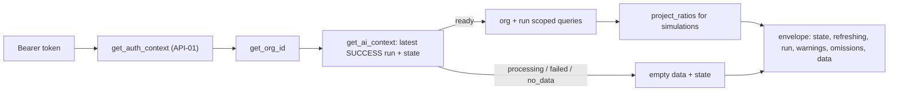

# API-05 — AI Output APIs

## 1. Overview

API-05 is the read-only HTTP layer that serves stored AI results to the UI: forecasts, anomalies,
recommendation cards and their three stored what-if simulations. It never computes anything. AI-06
already writes every row; API-01 already decides who the caller is and which organization they
belong to. API-05 only selects the right rows, shapes them, and says clearly what state the AI
layer is in (processing, no data, failed, ready).

It exists so the UI never has to read AI tables directly or guess what an empty list means. An
empty forecast list can mean "analysis still running", "workspace is empty", or "history too short";
API-05 tells the UI which one.

```text
UI ──GET──▶ API-05 (this task) ──SELECT──▶ forecasts / anomalies / recommendations /
                                           action_simulations / model_runs   (written by AI-06)
```

## 2. Scope

### In Scope

- Five read-only `GET` endpoints under `/api` (section 9).
- Organization scoping of every query, with the organization taken only from the validated token.
- A shared state block on every response: `state`, `refreshing`, `run`, `warnings`, `omissions`,
  `error_code`.
- Turning AI-06's zero sentinels for CPA/ROAS into `null` plus an explicit `unavailable` flag.
- Exposing "no forecast" campaigns and omitted-campaign metadata from AI-06's run metadata.

### Out of Scope

- Computing or modifying any AI output (AI-01 … AI-06).
- Triggering analysis and job polling (`POST /api/analysis/refresh`, `GET /api/jobs/{id}/status`).
- Human approve/reject of a card (INT-01 `POST /api/recommendations/{id}/decision`). API-05 only
  *shows* the stored `status`.
- Dispatching runs. Until WORK-04's real dispatcher exists, `model_runs` rows come only from
  fixtures or the AI-06 evidence script.
- Authentication itself (API-01) and any schema/migration change. API-05 adds no table, column,
  dependency or migration.

## 3. Prerequisites

| Task / Contract | Why Required |
|---|---|
| API-01 (`api/deps.py`) | `get_auth_context` validates the JWT, loads user/organization, checks membership. API-05 derives the organization only from it. |
| [AI-06](../ai/AI-06-pipeline-orchestrator.md) | Writes `model_runs` (with `execution_metadata`) and the four output tables. Defines the sentinel, omission and `no_data` / `insufficient_history` semantics that API-05 must expose. |
| [Pipeline contract](../contracts/ai-pipeline-and-persistence.md) | Run envelope (`request`, `outcome`, `omissions`), sentinel rule, "API-05 serves stored outputs". |
| [Simulation contract](../contracts/action-simulation.md) | Seven-day horizon `as_of+1 … as_of+7`; CPA = spend / conversions, ROAS = revenue / spend; zero denominator → unavailable. |
| INT-01 §2 endpoint table, `tests/contracts/canonical.json` | Source of field names (`value`/`ci_lower`/`ci_upper`, `metric_name`/`anomaly_score`, `problem`/`suggested_action`/`confidence_score`). Deviations are listed in section 9. |
| ADR 0001 | Runtime roles / RLS are deferred, so isolation here is application-level only (section 11). |

## 4. Architecture

```text
Bearer JWT
   ↓
get_auth_context (API-01)  →  get_org_id  →  organization_id
   ↓
routes/ai_outputs.py        validates campaign ownership, builds the envelope
   ↓
services/ai_outputs.py      resolves run + state, runs org-scoped queries, maps sentinels
   ↓
services/ai_tables.py       query-only Core table handles (no schema ownership)
   ↓
PostgreSQL                  rows written by AI-06
```

**Ownership boundaries**

| Concern | Owner |
|---|---|
| Who the caller is, which org | API-01 |
| Creating runs and all output rows | AI-06 (via Worker dispatch, WORK-04) |
| Human decision on a card (`recommendations.status`) | Separate API endpoint (not this task) |
| Serving stored outputs, states, sentinel projection | **API-05** |

## 5. Step-by-Step Implementation Walkthrough

### Practical Outcome

Once a run has been published, the UI can call `GET /api/forecasts` or `/api/recommendations` and
get that organization's rows plus a `state` it can render directly: a spinner for `processing`, an
empty-workspace message for `no_data`, an error banner for `failed`, data for `ready`. For a card,
`GET /api/recommendations/{id}/simulations` returns the three scenarios; the "pause" scenario shows
CPA/ROAS as `null` with `unavailable: ["cpa","roas"]`, never as a measured zero.

### Acceptance Criteria → Steps and Evidence

| Acceptance Criterion | Implementation Step(s) | Verification Evidence / Status |
|---|---|---|
| Organization-scoped forecast, anomaly, recommendation and stored-simulation endpoints | 1, 3, 4, 6 | `test_each_org_sees_only_its_own_outputs`, `test_other_orgs_ids_are_404` — NOT RUN (needs Postgres harness, see section 14) |
| Clear processing / no-data states | 2 | `test_states_no_data_and_processing` — NOT RUN (Postgres); pure parsing covered by logic tests — PASS |
| Canonical contract field names, safe organization scoping | 1, 3, 4 | Schemas reviewed against INT-01 / canonical names; isolation tests NOT RUN |
| AI-06: ratio sentinels exposed as unavailable | 5 | Logic tests (3 ratio cases) PASS; `test_pause_ratios_are_null_and_flagged` NOT RUN |
| AI-06: missing-history and omitted-campaign states visible | 2, 4 | `parse_metadata` + `campaigns_without_forecast` logic tests PASS; end-to-end NOT COVERED (section 15) |

### Step 1 — Take the organization from the token only

- **What:** Guarantee the organization never comes from the URL, query string or body.
- **Where:** `routes/ai_outputs.py` — `get_org_id`, `OrgId`.
- **How it works:** `get_org_id` depends on API-01's `get_auth_context` and returns
  `auth.organization.id`. Missing, invalid or expired token, or a user who is not a member, is
  rejected by API-01 with 401 before any API-05 code runs. Every service function receives this
  `org_id` as an argument. This differs from the dashboard routes (`/orgs/{org}/...` + `OrgAuth`):
  there is no `{org}` in these paths, so nothing needs matching.
- **Testing:** Isolation tests override `get_org_id`; the JWT path itself is API-01's evidence.

### Step 2 — Resolve the AI state for the organization

- **What:** Decide `processing` / `no_data` / `failed` / `ready` and which run to serve.
- **Where:** `services/ai_outputs.py` — `get_ai_context`, `_latest_run`, `_has_active_job`, `_info`,
  `parse_metadata`.
- **How it works:**
  1. Find the organization's newest run by `started_at`, and the newest `SUCCESS` run.
  2. `running` = newest run is `RUNNING`, **or** the organization has a `PENDING`/`RUNNING` job.
  3. A `SUCCESS` run exists → `ready` (`refreshing = running`) and data is served from that run.
     If its outcome warnings contain `no_data`, state is `no_data`.
  4. No `SUCCESS` run, `running` → `processing`.
  5. No `SUCCESS` run, not running, newest run `FAILED` → `failed` with `error_code` = stored
     `error_message` (a safe code, cut to 64 chars; `unknown` if empty).
  6. Anything else (no run at all, or only `CANCELLED` / `PARTIAL_SUCCESS`) → `no_data`.

  `parse_metadata` reads `execution_metadata.request.as_of`, `outcome.warnings` and `omissions`
  defensively: NULL, legacy or malformed metadata gives `(None, [], [])`, never an exception.
- **Testing:** Logic tests for `parse_metadata`; `test_states_no_data_and_processing` (NOT RUN).

### Step 3 — Query only the served run, always with the organization predicate

- **What:** Read the rows of the chosen run.
- **Where:** `list_forecasts`, `list_anomalies`, `list_recommendations`, `campaign_exists`.
- **How it works:** Each statement filters `organization_id == org_id` **and**
  `model_run_id == <served run>`. Recommendations left-join `campaigns` (also org-filtered) to add
  `campaign_name`. Routes call `_run_id(ctx)`, which returns a run id only when `state == "ready"`,
  so `processing`, `failed` and `no_data` return an empty `data` list. If a `campaign_id` filter is
  given, `_require_campaign` first checks the campaign belongs to the organization.
- **Testing:** `test_each_org_sees_only_its_own_outputs`, `test_other_orgs_ids_are_404` (NOT RUN).

### Step 4 — Resolve a card's simulations through its parent

- **What:** Serve the three stored scenarios of one recommendation.
- **Where:** `get_recommendation_run_id`, `get_run_context`, `list_simulations`, route
  `get_simulations`.
- **How it works:** `action_simulations` has no `organization_id` column, so ownership is derived:
  the recommendation is looked up with an org predicate (`get_recommendation_run_id`), the run
  context is read for that recommendation's own run, and `list_simulations` joins
  `action_simulations → recommendations` with the org predicate again. Unknown and foreign IDs both
  return 404 `recommendation_not_found`. The card is addressed by id, so cards of older runs of the
  same organization remain reachable. The response adds `horizon_start`/`horizon_end`
  (`as_of+1 … as_of+7`) from the run's `as_of`.
- **Testing:** `test_other_orgs_ids_are_404`, `test_pause_ratios_are_null_and_flagged` (NOT RUN).

### Step 5 — Project the ratio sentinels

- **What:** Never present AI-06's stored `0` placeholder as a measured value.
- **Where:** `services/ai_outputs.py` — `project_ratios`, used by `list_simulations`.
- **How it works:** `projected_cpa` is `null` and `"cpa"` is added to `unavailable` when
  `projected_conversions == 0`; `projected_roas` is `null` and `"roas"` is added when
  `projected_spend == 0`. Otherwise the stored value is returned unchanged, including a genuine
  zero (e.g. spend 100, conversions 5, revenue 0 → ROAS `0`). Scenarios are sorted
  `budget_decrease_20`, `budget_increase_15`, `pause`.
- **Testing:** Three logic tests — PASS.

### Step 6 — Shape the responses and register the router

- **What:** One envelope for every endpoint.
- **Where:** `schemas/ai_outputs.py` (`AiStateInfo`, `AiList[T]`, `ForecastList`, `SimulationList`
  and row models); `routes/ai_outputs.py` (`router = APIRouter(prefix="/api")`).
- **How it works:** Routes merge `ctx.model_dump()` with `data` (plus `campaigns_without_forecast` or
  the horizon). `campaigns_analyzed` is carried on the state object only to derive
  `campaigns_without_forecast` and is excluded from JSON. The router must be included in
  `api/main.py` **without an extra prefix**:
  `app.include_router(ai_outputs.router)`.
- **Testing:** Router import lists the five `GET` routes in section 9 — PASS (section 14).

### Flow Diagram



## 6. Inputs

All endpoints are `GET` and require `Authorization: Bearer <token>`. No request body.

| Input | Endpoint(s) | Type | Required | Description |
|---|---|---|---|---|
| organization | all | from token | yes | Never a request field. |
| `campaign_id` | forecasts, anomalies, recommendations | UUID | no | Must belong to the organization, otherwise 404 `campaign_not_found`. |
| `metric` | forecasts | string | no | Exact match on `metric_name`; not validated against a list. |
| `from`, `to` | anomalies | date | no | Inclusive range on `detected_at` (UTC date). `to` covers the whole day. |
| `status` | recommendations | `pending`, `approved`, `rejected`, `marked_done`, `needs_review` | no | Other values → 422. |
| `limit` | anomalies, recommendations | int 1–1000 | no, default 200 | Out of range → 422. |
| `offset` | anomalies, recommendations | int ≥ 0 | no, default 0 | |
| `recommendation_id` | simulations | UUID path | yes | Unknown or foreign → 404 `recommendation_not_found`. |

## 7. Outputs

**State block (every response)**

| Field | Type | Nullable | Description |
|---|---|---|---|
| `state` | `processing` \| `no_data` \| `failed` \| `ready` | no | See section 8. |
| `refreshing` | bool | no | A newer run or job is active while the last `SUCCESS` run is served. |
| `run` | `{id, status, as_of, completed_at}` | yes | The run being described. `null` when no run exists or a bare processing state. |
| `warnings` | string[] | no | Outcome warning codes from the run (e.g. `insufficient_history`, `undefined_ratios`, `no_data`). |
| `omissions` | `{campaign_id, reason, window_start, window_end, omitted_rule_ids}[]` | no | Campaigns whose cards/simulations were skipped (missing baseline week). |
| `error_code` | string | yes | Only when `state = failed`; safe code, never internals. |

**Endpoint data** (`data` is a list unless noted)

| Endpoint | Item fields |
|---|---|
| Forecast | `id, campaign_id, metric_name, forecast_date, value, ci_lower?, ci_upper?, model_used?, created_at`. Response adds `campaigns_without_forecast: UUID[]`. |
| Anomaly | `id, campaign_id, metric_name, detected_at, anomaly_score, severity, direction, created_at`. `detectors_triggered` is deliberately not exposed. |
| Recommendation | `id, campaign_id, campaign_name?, source_anomaly_id?, problem, evidence, suggested_action?, confidence_score?, risk_rating?, severity?, status, created_at`. |
| Simulation | `id, recommendation_id, scenario_type, projected_spend, projected_conversions, projected_cpa?, projected_roas?, unavailable: ("cpa"\|"roas")[], created_at`. Response adds `horizon_start`, `horizon_end`. |

`Decimal` values are serialized by Pydantic as JSON strings; the UI must parse them. `evidence` is
passed through as stored (JSON array of strings including AI-06's appended rule/simulator lines).

## 8. Rules and Semantics

**State resolution** (full logic in step 2)

| `state` | When |
|---|---|
| `ready` | A `SUCCESS` run exists. `refreshing: true` if a newer run is `RUNNING` or a `PENDING`/`RUNNING` job exists. Data comes from the newest `SUCCESS` run. |
| `no_data` | The served `SUCCESS` run carries the `no_data` warning (empty workspace), or there is no run / no successful run and nothing active and the newest run is not `FAILED`. |
| `processing` | No `SUCCESS` run yet and a run or job is active. |
| `failed` | No `SUCCESS` run, nothing active, newest run `FAILED`. |

- **Insufficient history:** state stays `ready`; the code appears in `warnings`, and
  `campaigns_without_forecast` lists analyzed campaigns without a forecast row. A missing forecast
  is never returned as zero.
- **Incomplete baseline:** state stays `ready`; the campaign appears in `omissions` and has no
  cards/simulations.
- **Missing / legacy metadata:** `execution_metadata` NULL or malformed → no warnings, no omissions,
  `run.as_of = null`; simulation `horizon_*` are `null`.
- **Zero denominators:** CPA unavailable when conversions = 0; ROAS unavailable when spend = 0. A
  zero with a non-zero denominator is a real value and is kept.
- **Ordering:** forecasts by campaign, metric, date; anomalies by `detected_at` desc, metric, id;
  recommendations by `severity` desc (nulls last), `created_at` desc, id; simulations in the fixed
  scenario order.
- **Duplicates:** none expected; AI-06 writes one row per key per run, and each endpoint serves a
  single run.
- **Determinism:** read-only; the same stored rows give the same response.

## 9. Public Interfaces

All under `apps/backend/src/sawakli/api/routes/ai_outputs.py`. No side effects (reads only).

| Endpoint | Returns | Errors |
|---|---|---|
| `GET /api/ai/status` | State block only | 401 |
| `GET /api/forecasts?campaign_id=&metric=` | `ForecastList` (not paginated) | 401, 404 `campaign_not_found` |
| `GET /api/anomalies?campaign_id=&from=&to=&limit=&offset=` | `AiList[AnomalyOut]` | 401, 404, 422 |
| `GET /api/recommendations?campaign_id=&status=&limit=&offset=` | `AiList[RecommendationOut]` | 401, 404, 422 |
| `GET /api/recommendations/{recommendation_id}/simulations` | `SimulationList` (3 rows) | 401, 404 `recommendation_not_found` |

`recommendations` and `anomalies` and `forecasts` serve the newest `SUCCESS` run only. The
simulations endpoint serves the run that owns the card.

**Differences from the INT-01 §2 table** (INT-01 is guidance, not a bible; these were chosen for
simplicity and safety)

| INT-01 | Implemented | Reason |
|---|---|---|
| `GET /api/campaigns/{id}/forecasts` | `GET /api/forecasts?campaign_id=` | One route for org-wide and per-campaign reads. |
| `GET /api/campaigns/{id}/anomalies` | `GET /api/anomalies?campaign_id=` | Same. |
| `GET /api/recommendations?organization_id=&status=` | no `organization_id` param | The organization must come from the token, never the request. |
| `GET /api/recommendations/{id}/simulate` | `.../simulations` | Names the collection of three rows. |
| `{"status":"processing"}` | `state` field in a common envelope | Same envelope for all states. |
| Nested `{"error": {code, message, user_message, retryable}}` | FastAPI `{"detail": "..."}` | Reuses API-01 error behavior; the UI must map these. |
| — | `GET /api/ai/status` (new) | Lets the UI show state without fetching data. |

## 10. Data Ownership

### Reads

- `model_runs` (id, status, campaigns_analyzed, error_message, completed_at, execution_metadata),
  scoped by `organization_id`.
- `forecasts`, `anomalies`, `recommendations` (scoped by `organization_id` and `model_run_id`).
- `action_simulations`, only through a join to `recommendations` with the organization predicate.
- `campaigns` (existence and `name`, scoped by `organization_id`).
- `jobs` (existence of a `PENDING`/`RUNNING` job for the organization, to set `refreshing`).

### Writes

None. API-05 never inserts, updates or deletes.

### Must Never Read

Tokens, credentials, password fields, `connector_tokens`, provider response bodies, other
organizations' rows, and `anomalies.detectors_triggered` (UI-excluded).

### Must Never Write

All AI output tables, `model_runs`, `jobs`, and `recommendations.status` (human decisions belong to
a separate endpoint).

## 11. Security

- **Authentication:** API-01 `get_auth_context`; 401 for missing, invalid, expired token or no
  membership.
- **Organization isolation:** the organization comes only from the token. Every query carries an
  explicit `organization_id` predicate; simulations are scoped through their parent card. The
  shared `apply_org_scope` helper is not used because it accepts ORM classes and these are Core
  table handles, so each predicate is written explicitly and covered by tests.
- **No existence leak:** a foreign ID and a non-existent ID return the same 404 and message.
- **Safe errors:** `error_code` carries only AI-06's stored safe code; no SQL, trace or exception
  text is returned.
- **Sensitive fields:** no tokens or secrets are read. `detectors_triggered` is not exposed.
- **Trust boundary:** application-level isolation only; runtime least-privilege roles and RLS
  (ADR 0001) remain deferred, and superuser test connections do not prove them.
- **Pagination cap:** `limit ≤ 1000`.

## 12. Error and Edge-Case Behavior

| Case | Expected Behavior |
|---|---|
| Missing / bad / expired token | 401 from API-01. |
| Malformed input (bad UUID, bad date, unknown `status`, `limit` out of range) | 422 from FastAPI validation. |
| Foreign or unknown `campaign_id` / `recommendation_id` | 404 `campaign_not_found` / `recommendation_not_found`, identical for both cases. |
| No run exists | `state: no_data`, empty `data`. |
| Run active, no earlier success | `state: processing`, `refreshing: true`, empty `data`. |
| Run active, earlier success | `state: ready`, `refreshing: true`, last success served. |
| Latest run `FAILED`, no earlier success | `state: failed`, `error_code` set, empty `data`. |
| Empty workspace (AI-06 `no_data` warning) | `state: no_data`, empty `data`. |
| Insufficient history | `ready`, `insufficient_history` warning, campaign in `campaigns_without_forecast`. |
| Incomplete baseline week | `ready`, campaign in `omissions`, no cards/simulations for it. |
| Zero denominators | CPA/ROAS `null` + `unavailable`. |
| NULL / legacy `execution_metadata` | Served without warnings/omissions; `as_of` and horizon `null`. |
| Duplicate records | Not expected (one run per response). |
| Database failure | Unhandled exception → 500 from FastAPI; no data is fabricated. |
| Provider or API failure | N/A — API-05 makes no provider calls. |
| Timeout / cancellation | N/A — read-only requests. A `CANCELLED` newest run with no success yields `no_data`. |

## 13. Testing

### Unit Tests

`tests/test_ai_outputs_logic.py` (no database):

- Pause scenario (spend 0, conversions 0) → CPA and ROAS `None`, `unavailable == ["cpa","roas"]`.
- Zero conversions only hides CPA; ROAS kept.
- A measured zero ROAS with non-zero spend is kept (`unavailable == []`).
- `parse_metadata` returns `(None, [], [])` for NULL, junk and wrong-typed input.
- `parse_metadata` reads `as_of`, `warnings`, valid `omissions`, and skips invalid omission items.
- `horizon` is `as_of+1 … as_of+7`, and `(None, None)` without `as_of`.
- `campaigns_without_forecast` lists analyzed campaigns lacking rows and respects `campaign_id`.

### Integration Tests

`tests/test_ai_outputs_isolation.py` (PostgreSQL; fixtures `client`, `db_session`; seeds real rows
and cleans up after itself):

- `test_each_org_sees_only_its_own_outputs`: two organizations, each sees exactly its own one
  forecast, anomaly, recommendation, and three simulations.
- `test_other_orgs_ids_are_404`: org A gets 404 for org B's recommendation and for org B's
  `campaign_id` on all three list endpoints.
- `test_pause_ratios_are_null_and_flagged`: scenario order, pause ratios `null`,
  `unavailable == ["cpa","roas"]`, horizon `2026-11-21 … 2026-11-27`.
- `test_states_no_data_and_processing`: empty organization → `no_data` with empty data; organization
  with only a `RUNNING` run → `processing`, `refreshing: true`, empty recommendations.

### E2E Impact

The UI can consume these endpoints now. Real data appears only after WORK-04 dispatches runs; until
then, outputs exist only from fixtures or `scripts/ai06_evidence.py`. The UI owner must map the
`state` values and the `{"detail": ...}` error shape.

## 14. Verification

Commands executed (2026-11-27, Africa/Cairo), in an isolated copy containing only the five API-05
source files plus the two test files, with a minimal stub of API-01's `deps.py`:

```bash
PYTHONPATH=src python3 -m pytest tests/test_ai_outputs_logic.py -q
ruff format --check src tests
ruff check src tests
mypy src/sawakli/api/schemas src/sawakli/api/services src/sawakli/api/routes   # strict = true
python3 -c "from sawakli.api.routes.ai_outputs import router; ..."   # list registered routes
```

Environment: CPython 3.13.18, FastAPI 0.165.0, SQLAlchemy 2.1.9, Pydantic 2.13.5.

| Check | Result |
|---|---|
| Logic unit tests | PASS — 7 passed |
| `ruff format --check` on the API-05 files | PASS |
| `ruff check` | PASS apart from `DTZ001` (naive `datetime(...)`) in the two test files under this environment's default rules; the repo's own ruff config decides whether it applies |
| `mypy --strict` on schemas, services, routes | PASS — no errors in the API-05 files |
| Router registers the five `GET` routes | PASS |
| Isolation / state integration tests | NOT RUN — needs the repo's Postgres test harness |
| Full backend regression, `alembic upgrade head`, CI | NOT RUN — not available in this environment |
| Router included in `api/main.py` | NOT VERIFIED — the `main.py` supplied earlier did not include it |

CI run or pull request evidence: N/A — not provided at the time of writing.

## 15. Known Limitations

- **Failure of a newer run is hidden** when an older `SUCCESS` run exists: the UI sees `ready` with
  the last good data and `refreshing: false`.
- **Cards disappear on refresh.** Lists serve the newest `SUCCESS` run only, so cards of an older run
  (and any human decision on them) are no longer listed after a new run, although
  `.../simulations` still resolves them by id. Product decision pending.
- **Test gaps:** no test yet for 401 without a token through the real dependency, pagination, `status`
  and date-range filters, `refreshing` with an earlier success, the `failed` state, omissions and
  `insufficient_history` end to end, or NULL `execution_metadata`.
- **Seed assumptions:** the integration seed inserts `organizations` without `plan` and
  `data_sources` without `created_at`; this relies on database defaults and must pass on the real
  harness.
- **Duplicated table handles:** `services/ai_tables.py` re-declares handles that already exist in
  `sawakli.db.tables`. Both must be kept in sync with migrations until consolidated.
- **Sentinels are derived, not read:** unavailable ratios are inferred from zero denominators, not
  from AI-06's stored `undefined_ratios` evidence marker.
- **No total counts:** paginated lists return no total; forecasts are not paginated.
- **`metric` filter** is not validated; an unknown metric returns an empty list and lists every
  analyzed campaign in `campaigns_without_forecast`.
- **Decimals as strings** in JSON.
- **Python 3.12+ syntax** (`class AiList[T]`); matches AI-06's CPython 3.12.3 environment.

## 16. Follow-Up Tasks

- Recommendation decision endpoint (INT-01 `POST /api/recommendations/{id}/decision`, 409 on
  optimistic lock) — task ID and owner to be confirmed.
- Register `ai_outputs.router` in `api/main.py` and run the integration tests on the real harness —
  Ahmed, before the PR.
- WORK-04 — El-Farouk — real dispatch so runs exist outside fixtures.
- UI owner — consume `state`, `warnings`, `omissions`, `unavailable`, and the `{"detail"}` errors.
- AI-07 — Hussein / QA — broader isolation and coverage acceptance.
- Consolidate `ai_tables.py` with `sawakli.db.tables` — Ahmed — remove duplicate handles.
- Decide whether to surface a failed newer run and whether to keep older cards visible — Ahmed with
  Hussein.
- Add the missing tests listed in section 15 — Ahmed.

## 17. References and Evidence

- Notion task: N/A — link not provided.
- Pull request: N/A — not yet opened / link not provided.
- Canonical contracts: INT-01 §2 endpoint table; `tests/contracts/canonical.json`;
  [AI pipeline and persistence contract](../contracts/ai-pipeline-and-persistence.md);
  [Action simulation contract](../contracts/action-simulation.md).
- ADRs: ADR 0001 (runtime boundaries and database roles); ADR 0002 (AI pipeline and persistence
  boundaries).
- Related technical documentation: [AI-06](../ai/AI-06-pipeline-orchestrator.md); API-01 guidance
  (login, sessions, organization isolation).
- Source: `apps/backend/src/sawakli/api/routes/ai_outputs.py`,
  `schemas/ai_outputs.py`, `services/ai_outputs.py`, `services/ai_tables.py`.
- Tests: `apps/backend/tests/test_ai_outputs_logic.py`,
  `apps/backend/tests/test_ai_outputs_isolation.py`.
