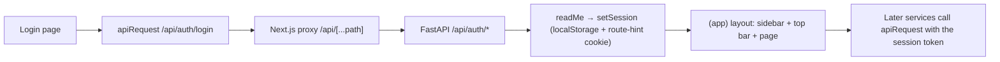

# UI-02 — Frontend Foundation and API Client

## 1. Overview

UI-02 supplies the active Next.js shell, protected routes, navigation, browser session handling,
and a typed UI-to-API boundary.

## 2. Scope

### In Scope

- App/auth route structure, sidebar, top bar, and route guard.
- Typed API client, error translation, and same-origin FastAPI proxy.
- UI-01 design-token reuse and focused frontend tests.

### Out of Scope

- API authentication, JWT creation, organization authorization, CORS policy, or persistence.
- Dashboard/business APIs, CSV ingestion, OAuth, AI output, export, and UI-04–UI-09 features.

## 3. Prerequisites

| Task / contract | Why required |
|---|---|
| UI-01 | Provides the existing visual tokens and layout patterns. |
| DEV-01 | Provides the Next.js application and Compose API URLs. |
| API-01 | Defines the auth routes and authenticated organization boundary. |

No ADR or canonical frontend API contract exists in `docs/contracts` at this commit.

## 4. Architecture

```text
Browser page → /api/* Next.js proxy → FastAPI /api/* → Backend contract
```

The proxy uses `API_INTERNAL_URL`, then `NEXT_PUBLIC_API_URL`, then the local development default.
It forwards method, content type, and bearer token only; it does not inspect or persist tokens.

## 5. Step-by-Step Implementation Walkthrough

### Practical Outcome

A user opens Sawakli and lands on `/login`. They sign in with their Sawakli account. The browser
sends the credentials to the same-origin `/api/auth/login` route, which the Next.js proxy forwards
to FastAPI. The UI then reads `/api/auth/me` with the returned token and stores the user,
organization and token as the browser session. From then on every page in the `(app)` group shows
the same sidebar (Dashboard, Campaigns, Recommendations, Reports, Settings, with the user and
organization name) and the same top bar (page title and dark-mode toggle). Every later UI screen
calls the API through one typed client that turns API failures into a safe `ApiError` instead of a
fake success.

Terms:

- **Same-origin proxy:** the browser only calls the Next.js server (`/api/...`); the Next.js server
  calls FastAPI. The browser therefore never needs FastAPI's CORS settings.
- **Route hint cookie:** a cookie that only tells the Next.js middleware "a session probably
  exists". It is not authorization; the API checks the bearer token on every request.

The walkthrough describes the code on this branch. The shell came from the original UI-02 commit
`51f9d5a` (24 Aug 2026); the API client, proxy and real session came from PR #22 (`ad06224`,
1 Oct 2026). Three later pieces belong to UI-04, not UI-02, and are documented in
[UI-04 §5 Step 5](UI-04-dashboard-kpis-and-campaign-table.md#5-step-by-step-implementation-walkthrough):
`hooks/useSession.ts`, `lib/auth-redirect.ts`, and the 401 handling in
`components/providers/query-provider.tsx`.

### Acceptance Criteria → Steps and Evidence

The criteria are quoted from the Definition of Done on the Notion card "UI-02 — Build Next.js
Frontend Structure, Layout and API Client" (team Notion export of 21 Oct 2026).

| Acceptance Criterion | Implementation Step(s) | Verification Evidence / Status |
|---|---|---|
| "Next.js app runs in the shared environment." | 1, 3 | `npm run build` PASS (Section 14). `docker-compose.yml` sets `API_INTERNAL_URL: http://api:8000` for the web service, which the proxy reads first. A run of the full Compose stack: NOT RUN — not started in this documentation update; PR #22 recorded Docker as unavailable. UI-04 §14 records a live local run of `next dev` behind this proxy against a running API. |
| "Routing/layout structure and reusable API client/types are clean and documented." | 1, 2, 3, 4, 5 | This document. `npm run lint` and `npm run type-check` PASS. `tests/api-client.test.ts` PASS (Section 14). |
| "Header/sidebar/navigation work across pages." | 1 | `tests/home.test.tsx` (root redirects to `/dashboard`) PASS. No dedicated sidebar/top-bar test exists (Section 15). UI-04 §14 live run navigated the dashboard, campaigns and campaign detail pages with the shell. |

### Step 1 — Route groups, shared layout and navigation

- **What:** Give every product page the same shell and keep sign-in pages outside it.
- **Where:**
  - `apps/web/src/app/page.tsx` (redirects `/` to `/dashboard`)
  - `apps/web/src/app/(app)/layout.tsx` (`Sidebar`, `Topbar`, `ROUTE_TITLES`, `getTitle`)
  - `apps/web/src/app/(auth)/` (`login`, `setup/organization`, `setup/connector`)
  - `apps/web/src/components/layout/sidebar.tsx`, `topbar.tsx`
- **How it works:**
  - `(app)/layout.tsx` renders the sidebar, then the top bar with a title from `ROUTE_TITLES`
    (`/campaigns/<id>` becomes "Campaign Details"), then the page.
  - `NAV_ITEMS` holds the five routes. A link is active on an exact match, or on a child path for
    every route except `/dashboard`.
  - The sidebar reads the session only after mount (`useSyncExternalStore` returning `false` on the
    server), so server and client HTML match. It shows the user and organization name from the
    session, or "Guest".
  - The top bar's theme toggle uses the same mount check and the UI-01 tokens.
- **Testing:** `tests/home.test.tsx` checks the root redirect. The layout itself has no component
  test; see Section 15.

### Step 2 — Typed API client and safe errors

- **What:** One function for every UI call to the API, with one error type.
- **Where:** `apps/web/src/lib/api-client.ts` (`apiRequest<T>`, `ApiError`, `readProblem`,
  `messageFor`).
- **How it works:**
  - `apiRequest<T>(path, options)` calls `fetch` on a same-origin path. When `accessToken` is
    given, it sets `Authorization: Bearer <token>`.
  - On a 2xx response it returns the parsed JSON as `T`.
  - On any other status it reads FastAPI's `detail`. A string becomes the message; an object keeps
    its `code`, `message` and `retryable` fields. Unreadable bodies are ignored.
  - Without an API message, 401, 403 and 404 get fixed safe messages; anything else gets a generic
    retry message.
  - `retryable` defaults to `true` for 5xx and `false` otherwise, unless the API says otherwise.
  - The client never returns mock or default data on failure; it throws `ApiError`.
- **Testing:** `tests/api-client.test.ts` checks token forwarding, JSON return, and the
  `invalid_csv` 422 mapping to `ApiError`.

### Step 3 — Same-origin proxy to FastAPI

- **What:** Forward browser `/api/*` calls to FastAPI from the Next.js server.
- **Where:** `apps/web/src/app/api/[...path]/route.ts` (`apiBaseUrl`, `proxy`; `GET` and `POST`
  exports).
- **How it works:**
  - The base URL is `API_INTERNAL_URL`, then `NEXT_PUBLIC_API_URL`, then
    `http://localhost:8000`, without a trailing slash.
  - The target is `<base>/api/<path>` with the original query string.
  - Only the `authorization` and `content-type` request headers are forwarded. The body is
    forwarded as raw bytes for non-GET/HEAD requests (this keeps multipart CSV uploads intact).
  - The upstream status and body pass through unchanged, with only `content-type` copied back.
  - If FastAPI cannot be reached, the proxy answers 503 with
    `detail.code = "api_unavailable"` and `retryable: true`.
  - The route is `force-dynamic` and uses `cache: 'no-store'`, so responses are never cached.
- **Testing:** Covered by `npm run build` and by live use (UI-04 §14). There is no unit test of
  the route handler; see Section 15.

### Step 4 — Browser session and route guard

- **What:** Remember who is signed in and keep signed-out users on public pages.
- **Where:** `apps/web/src/lib/session.ts` (`getSession`, `setSession`, `clearSession`;
  previously `lib/mock-auth.ts`), `apps/web/src/middleware.ts`.
- **How it works:**
  - `setSession` stores `{ user, organization, access_token }` in `localStorage` under
    `sawakli-session` and sets the `sawakli-auth=1` route hint cookie.
  - `getSession` returns `null` on the server, caches the parsed value while the raw string is
    unchanged, and treats invalid JSON as no session.
  - `clearSession` removes both.
  - The middleware lets `/samples/*`, `/login` and `/setup/organization` through. Without the
    cookie, any other page redirects to `/login`; with it, `/login` redirects to `/dashboard`.
  - The matcher skips `api`, so the proxy is never redirected.
- **Testing:** No unit test of `session.ts` or the middleware; behavior was checked through the
  login flow (UI-04 §14). See Section 15.

### Step 5 — Typed auth service and login

- **What:** Use the client for API-01 sign-in and build the session from the API's answer.
- **Where:** `apps/web/src/services/auth.service.ts` (`login`, `register`, `readMe`),
  `apps/web/src/app/(auth)/login/page.tsx`, `apps/web/src/app/(app)/settings/page.tsx`.
- **How it works:**
  - The login page calls `login` (`POST /api/auth/login`), then `readMe` (`GET /api/auth/me`)
    with the new token, then `setSession({ ...me, access_token })`, then goes to
    `/setup/connector`.
  - The organization comes only from `/api/auth/me`; the UI never sends an organization id to
    authenticate.
  - A 401 shows "Invalid email or password"; other `ApiError`s show their safe message.
  - Settings → Log out calls `clearSession` and returns to `/login`.
- **Testing:** The login page and `auth.service.ts` have no dedicated test; see Section 15.
  `tests/connector-setup.test.tsx` mocks `getSession` for the UI-03 setup flow only.

### Flow Diagram



## 6. Inputs

| Input | Type | Required | Source | Meaning |
|---|---|---:|---|---|
| API path | string | Yes | UI service | Same-origin path such as `/api/auth/login`. |
| bearer token | string | Protected requests | API-01 login | Forwarded as `Authorization`. |
| backend error detail | string/object | No | FastAPI | Converted to a safe `ApiError`. |

## 7. Outputs

| Output | Type | Consumer | Meaning |
|---|---|---|---|
| parsed API result | generic `T` | UI services/pages | Contract-shaped successful response. |
| `ApiError` | error | UI pages | Safe message plus status/code/retryability. |
| session | browser storage | protected UI | User, organization, and bearer token from API-01. |

## 8. Rules and Semantics

- A 401 produces a sign-in-again message; API authorization remains authoritative.
- The middleware cookie is a route hint only, not server authorization.
- Failed/unavailable API calls never become mock successful responses.
- The proxy avoids a browser CORS dependency; API CORS remains owned by Backend deployment.

## 9. Public Interfaces

- `apiRequest<T>(path, options)` — calls the same-origin proxy and returns typed JSON or `ApiError`.
- `POST /api/*` and `GET /api/*` Next.js route handler — forwards approved API requests to FastAPI.

## 10. Data Ownership

### Reads

- Auth and connector API responses.
- Existing browser session only for user, organization, and bearer token.

### Writes

- Existing browser session storage and route-hint cookie.

### Must Never Read

- Database, provider credentials, encryption keys, or connector tokens.

### Must Never Write

- Organization-owned records or provider tokens.

## 11. Security

The browser sends the API-01 bearer token only to the same-origin proxy. The API derives
organization scope from that token. No organization ID is sent by UI. The current browser-storage
session is documented as a limitation; a future approved API/session contract may use HTTP-only
cookies.

## 12. Error and Edge-Case Behavior

| Case | Behavior |
|---|---|
| 401 | Explain that the session expired; user signs in again. |
| 403/404 | Display safe generic permission/not-found message. |
| typed connector error | Preserve safe code/message/retryable fields. |
| proxy/API unavailable | Return safe retryable 503 response. |
| invalid session storage | Treat as no session. |

## 13. Testing

### Unit Tests

- `api-client.test.ts` proves token forwarding and safe error mapping.

### Integration Tests

- The proxy and real API need an API-01/API-03 deployment for HTTP integration verification.

### E2E Impact

- UI-03’s focused component test covers the CSV request choreography; browser E2E remains follow-up.

## 14. Verification

Executed 2026-10-01 from `apps/web` after merging PR #16:

- `node_modules/.bin/eslint.cmd .` — PASS; two pre-existing unused `_orgId` warnings in mock campaign/recommendation services.
- `node_modules/.bin/tsc.cmd --noEmit` — PASS.
- `node_modules/.bin/vitest.cmd run` — PASS; 3 files, 6 tests.
- `node_modules/.bin/next.cmd build` — PASS; Next.js reports the repository’s existing middleware-to-proxy deprecation warning.

Re-run on 13 Nov 2026, local Windows machine, Node v24.19.0, on branch
`feature/UI-04-dashboard-kpis-campaign-table` after merging `main` `261a9ba` (PR #31 review update).
This document was converted to the 17-section format in the same update; no code changed.

From `apps/web`: `npm ci`, `npm run lint`, `npm run type-check`, `npm test`, `npm run build`.
From the repository root: `node scripts/run-contracts.mjs`.

- `npm ci` — PASS.
- `npm run lint` — PASS; 0 errors, 1 pre-existing unused `_orgId` warning.
- `npm run type-check` — PASS.
- `npm test` — PASS; 13 files, 83 tests.
- `npm run build` — PASS.
- `node scripts/run-contracts.mjs` — PASS; 6/6 (UI validator: no deviations).
- Full Docker Compose stack run — NOT RUN — not started in this documentation update.

## 15. Known Limitations

- API-01 returns one organization from `/api/auth/me`; no approved organization-list/switch contract exists.
- The API proxy is tested in frontend unit/build checks but not yet against a running local API stack.
- No dedicated tests exist for the proxy route handler, `session.ts`, the middleware, the login
  page, `auth.service.ts`, or the sidebar/top bar; they are covered only by build checks and live
  use.

## 16. Follow-Up Tasks

- ARCH-06 — UI owner — document and review the long-term API/session/state decision.
- API-07 — Backend owner — publish standardized error/OpenAPI contract.
- UI-08 — UI owner — consolidate product-wide loading, empty, error, and export states.

## 17. References and Evidence

- API-01 routes: `apps/backend/src/sawakli/api/routes/auth.py`.
- API client: `apps/web/src/lib/api-client.ts`.
- Proxy: `apps/web/src/app/api/[...path]/route.ts`.
- Tests: `apps/web/tests/api-client.test.ts`.
- Session and route guard: `apps/web/src/lib/session.ts`, `apps/web/src/middleware.ts`.
- Shell: `apps/web/src/app/(app)/layout.tsx`, `apps/web/src/components/layout/`.
- Notion card "UI-02 — Build Next.js Frontend Structure, Layout and API Client" (Definition of
  Done quoted in Section 5).
