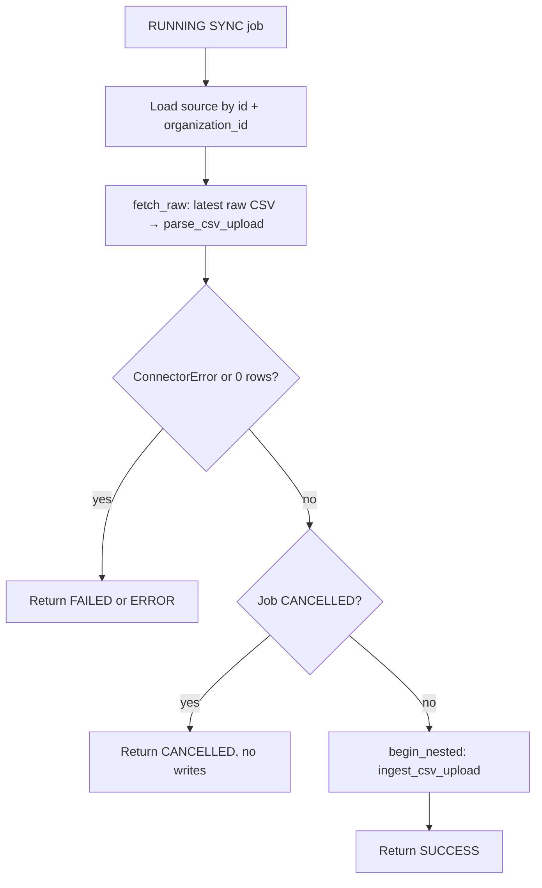

# WORK-03 — Connector Sync

## 1. Overview

WORK-03 makes the worker keep CSV demo sources fresh. On a schedule it finds due sources, creates
LOW-priority `SYNC` jobs, re-parses each source's latest stored upload, and persists the result
through Data-layer ingestion. This document describes the implemented scheduler, sync step,
freshness recording, and typed error handling (DoD 1 through DoD 4).

## 2. Scope

### In Scope

- Job type and source columns so an ANALYSIS job and a SYNC job can be open together.
- Identifying due `csv_demo` sources and inserting LOW `SYNC` jobs.
- `run_sync_job`: org-scoped source load, pins one stored upload across `fetch_raw` and ingestion,
  persists through `ingest_csv_upload`, and returns status to `loop.py`.
- Failure and timeout freshness updates through Data-owned `record_sync_failure`.
- Connector error classification, safe user-facing error persistence, and existing loop retry behavior.
- Dispatching `SYNC` jobs from `run_once` to `run_sync_job` while `ANALYSIS` still uses the
  placeholder.

### Out of Scope

- GA4 and ad-platform sync.
- Ranking LOW jobs by size, size-based timeouts, PARTIAL_SUCCESS, and a cancel endpoint.
- AI execution (WORK-04).
- GA4 and ad-platform error handling; only `csv_demo` is implemented.

## 3. Prerequisites

| Task / Contract | Why Required |
|---|---|
| [ING-01](../data/ING-01-csv-upload-ingestion-handoff.md) | `ingest_csv_upload` persists raw, canonical rows, and success freshness without committing. |
| [CONN-01](../connectors/CONN-01-csv-demo-parser.md) | `parse_csv_upload` returns `RawResponse` or `ConnectorError`. |
| [raw-response-canonical-handoff](../contracts/raw-response-canonical-handoff.md) | Idempotent raw insert and Data-owned canonical writes. |
| WORK-01 / WORK-02 | `run_once`, `_save_transition`, claim, retry, timeout, cancellation re-check. |

## 4. Architecture

```text
run_once
  → find_due_sources (interval) → insert LOW SYNC jobs
  → claim PENDING (HIGH first)
  → execute RUNNING:
        SYNC     → run_sync_job → fetch_raw → ingest_csv_upload
        ANALYSIS → execute_job (placeholder)
  → _save_transition (retry / illegal → FAILED)
  → db.commit()
```

Worker never writes `data_sources` freshness columns. Success freshness is written inside
`ingest_csv_upload`. Job status is written only in `loop.py`.

## 5. Step-by-Step Implementation Walkthrough

### Practical Outcome

A CSV source with a stored upload is picked up by the worker, re-ingested without duplicating the
raw row or campaigns, and the job ends `SUCCESS` when the parser produced at least one valid row.

### Acceptance Criteria → Steps and Evidence

| Acceptance Criterion | Implementation Step(s) | Verification Evidence / Status |
|---|---|---|
| Due sources identified by LOW SYNC jobs | 1.1, 1.2 | `tests/worker/test_source_scheduler.py`, `test_loop_sync.py` |
| Connector called; Data persists results | 2.1, 2.2 | `tests/worker/test_synch.py`, `test_loop_sync.py` |
| Success/failure freshness recorded | 3.1 | `record_sync_failure`, timeout handling, `test_sync_freshness.py` |
| Typed connector errors fail clearly | 4.1 | `test_sync_errors.py`: retryable, non-retryable, and unexpected failures |

### Step 1 — Shared job type and source

- **What:** Jobs carry `job_type` and optional `source_id`. Open-job uniqueness is one ANALYSIS per
  organization and one SYNC per source.
- **Where:** `shared/enums.py`, `db/models/jobs.py`, `alembic/versions/0014_jobs_job_type_and_source.py`.
- **How it works:** Existing `Job(...)` callers default to `ANALYSIS`. `/analysis/refresh` looks up
  in-flight ANALYSIS jobs only.
- **Testing:** `tests/worker/test_dedup.py`.

### Step 2 — Due sources and LOW job creation

- **What:** `find_due_sources` is read-only. `run_once` inserts LOW SYNC jobs on
  `sync_check_every_seconds`.
- **Where:** `worker/scheduler/source_scheduler.py`, `worker/scheduler/loop.py`, `core/config.py`.
- **How it works:** A source is due when it is `csv_demo`, has a `raw_api_responses` row, is older
  than `sync_refresh_every_seconds` (or never synced), and has no open or recently created SYNC job.
- **Testing:** `test_source_scheduler.py`, `test_loop_sync.py`.

### Step 3 — Sync step

- **What:** `run_sync_job` loads the source with `id` and `organization_id`, fetches, checks
  cancellation, then ingests in a savepoint.
- **Where:** `worker/orchestration/synch.py`.
- **How it works:** `run_sync_job` selects the latest `raw_api_responses` row once and pins it in
  the source context passed to `fetch_raw`, which sends its CSV bytes to `parse_csv_upload`. Ingest
  uses the same row's `id`, endpoint, and payload, so a newer upload arriving during parsing cannot
  mismatch the parsed rows and raw metadata. `ON CONFLICT (id) DO NOTHING` adds no duplicate raw row.
  `run_sync_job` returns `JobStatus`; it does not commit.
- **Testing:** `tests/worker/test_synch.py`.

### Step 4 — Loop dispatch

- **What:** RUNNING `SYNC` jobs call `run_sync_job`; `ANALYSIS` still calls `execute_job`.
- **Where:** `worker/scheduler/loop.py`.
- **How it works:** Existing CANCELLED re-check, `_save_transition`, and `db.commit()` apply to
  syncs with no extra loop logic.
- **Testing:** `test_analysis_job_still_reaches_placeholder`, `test_sync_job_executes_on_second_tick`.

### Step 5 — Record failure freshness

- **What:** The Data layer records sync failures while preserving the last successful sync time.
- **Where:** `data/ingestion/service.py`, exported by `data/ingestion/__init__.py`.
- **How it works:** `record_sync_failure` updates `sync_status` and `last_error` with both source
  and organization IDs in the predicate. It does not commit or modify `last_synced_at`. Success
  freshness remains part of `ingest_csv_upload`.
- **Timeouts:** Before retrying a timed-out SYNC job, `loop.py` calls the Data function with the
  fixed message `The sync took too long and will be retried.`
- **Testing:** Data service unit test and `test_sync_freshness.py`.

### Step 6 — Typed failure outcomes

- **What:** Connector errors map to job status and safe source error text.
- **How it works:** Retryable errors return `ERROR`; non-retryable errors and zero valid rows
  return `FAILED`. Unexpected exceptions return `FAILED` with `Unexpected sync error.` The failure
  update runs after a failed ingestion savepoint has rolled back. Logs contain only job ID, source
  ID, and error kind.
- **Testing:** `test_sync_errors.py` covers backoff retries, final failure, parser failure, and
  generic unexpected errors.



## 6. Inputs

| Field / Input | Type | Required | Source | Description |
|---|---|---|---|---|
| `db` | `Session` | Yes | Worker tick | Caller owns commit. |
| `job` | `Job` | Yes | `loop.py` | Must be RUNNING; SYNC jobs set `source_id`. |
| `job.source_id` | UUID | Yes for SYNC | Jobs table | Data source to refresh. |
| `job.organization_id` | UUID | Yes | Jobs table | Tenant scope for the source query. |

## 7. Outputs

| Field / Output | Type | Nullable | Consumer | Description |
|---|---|---|---|---|
| Returned `JobStatus` | enum | No | `_save_transition` | SUCCESS, CANCELLED, FAILED, or ERROR. |
| Canonical campaigns / daily metrics | tables | — | Data consumers | Written only via `ingest_csv_upload`. |
| `data_sources.sync_status` / `last_synced_at` / `last_error` | columns | — | UI / scheduler | Data-owned success and failure freshness. |

## 8. Rules and Semantics

- Worker creates only LOW SYNC jobs.
- Source lookup always filters `id` and `organization_id`.
- Zero valid rows is a failure (`no_valid_rows`), matching the upload route.
- Parser `parse_warnings` do not change SUCCESS.
- Re-ingest uses upserts; campaign count stays stable across repeats.
- Cancel after fetch and before save writes nothing.
- Failure sets `sync_status = failed` and safe `last_error`, while preserving `last_synced_at`.
- A later success clears `last_error` and advances `last_synced_at`.
- Retryable errors use existing exponential backoff; non-retryable errors fail immediately.

## 9. Public Interfaces

### `find_due_sources(db, now)`

Read-only. Returns `DueSource(data_source_id, organization_id)` rows.

### `fetch_raw(db, source)`

Returns `RawResponse` or `ConnectorError`. Replaceable for tests and future connectors.

### `run_sync_job(db, job)`

Returns `JobStatus`. Does not write job status. Does not commit.

## 10. Data Ownership

### Reads

- `jobs`, `data_sources` (org-scoped), `raw_api_responses` (via source id).

### Writes

- Job rows: create SYNC jobs and status transitions in `loop.py` only.
- Canonical facts and success freshness: Data `ingest_csv_upload` only.

### Must Never Read

- Connector tokens, OAuth secrets, other organizations' sources.

### Must Never Write

- `data_sources.last_error` / failure freshness until DoD 3's Data-owned `record_sync_failure`.
- Job status from `synch.py`.
- A second persistence path that bypasses Data.

## 11. Security

Every source load uses both source id and `job.organization_id`. Cross-organization tests assert
that syncing organization A does not create campaigns or change freshness for organization B.

## 12. Error and Edge-Case Behavior

| Case | Expected Behavior |
|---|---|
| Missing source | Non-retryable `no_source_data` → `FAILED`; failure freshness update is org-scoped and safely affects no row if the source is absent. |
| No stored upload / missing CSV payload | Non-retryable `no_source_data` → `FAILED`; stores the user-facing message. |
| Parser `ConnectorError` | `ERROR` if retryable, else `FAILED`; stores `user_message`. |
| Zero valid rows | `FAILED` (`no_valid_rows`); stores its user-facing message. |
| Ingest exception | Savepoint rolls back; `FAILED` with generic `Unexpected sync error.`; raw exception text is not persisted. |
| Duplicate SYNC insert | Nested `IntegrityError` ignored in the scheduler. |
| Cancellation before save | Return `CANCELLED`; no canonical writes. |
| SYNC timeout | Stores `The sync took too long and will be retried.` then enters existing loop retry. |

## 13. Testing

### Unit Tests

- N/A for `fetch_raw` isolation beyond integration doubles in `test_synch.py`.

### Integration Tests

- `test_synch.py`: success, idempotent second run, cancel-before-save, cross-organization, and
  upload identity remains pinned if a newer upload arrives during parsing.
- `test_loop_sync.py`: scheduling, HIGH before LOW, ANALYSIS placeholder, two-tick SYNC execute.
- `test_sync_freshness.py`: failure then success, organization scope, timeout and retry freshness.
- `test_sync_errors.py`: retryable, non-retryable and unexpected error behavior.

### E2E Impact

- Worker reuses the same CSV → ingest path as the upload route; no new API contract.

## 14. Verification

Commands and results:

```bash
cd apps/backend
ruff check src/sawakli/worker/orchestration/synch.py src/sawakli/worker/scheduler/loop.py tests/worker/test_synch.py tests/worker/test_loop_sync.py
ruff format --check src/sawakli/worker/orchestration/synch.py src/sawakli/worker/scheduler/loop.py tests/worker/test_synch.py tests/worker/test_loop_sync.py
pytest tests/worker/test_synch.py tests/worker/test_loop_sync.py
```

- `ruff check src/sawakli/worker/orchestration/synch.py tests/worker/test_synch.py tests/worker/test_loop_sync.py` — PASS.
- `ruff format --check src/sawakli/worker/orchestration/synch.py tests/worker/test_synch.py tests/worker/test_loop_sync.py` — PASS after formatting the new test.
- `mypy src` — PASS.
- `ruff check src/sawakli/data/ingestion/service.py src/sawakli/data/ingestion/__init__.py src/sawakli/worker/orchestration/synch.py src/sawakli/worker/scheduler/loop.py tests/unit/data/ingestion/test_service.py tests/worker/test_sync_freshness.py tests/worker/test_sync_errors.py` — PASS.
- `ruff format --check` for the same seven files — PASS.
- `mypy src` — PASS.
- `pytest tests/unit/data/ingestion/test_service.py -q` — PASS (6 passed).
- `pytest tests/unit/data/ingestion/test_service.py tests/worker/test_synch.py tests/worker/test_loop_sync.py tests/worker/test_sync_freshness.py tests/worker/test_sync_errors.py -q` — NOT RUN — PostgreSQL unavailable. The unit tests completed, then the session-scoped Alembic fixture waited for the database at `localhost:5434`; Docker’s engine was unavailable to this session.

## 15. Known Limitations

- Only `csv_demo` with a stored `raw_api_responses` payload can sync.

## 16. Follow-Up Tasks

- WORK-04 — replace ANALYSIS placeholder with AI execution.

## 17. References and Evidence

- Canonical contracts: [ING-01](../data/ING-01-csv-upload-ingestion-handoff.md),
  [raw-response-canonical-handoff](../contracts/raw-response-canonical-handoff.md).
- Related: Worker Layer technical documentation (TRK-05), WORK-03 implementation guide.
